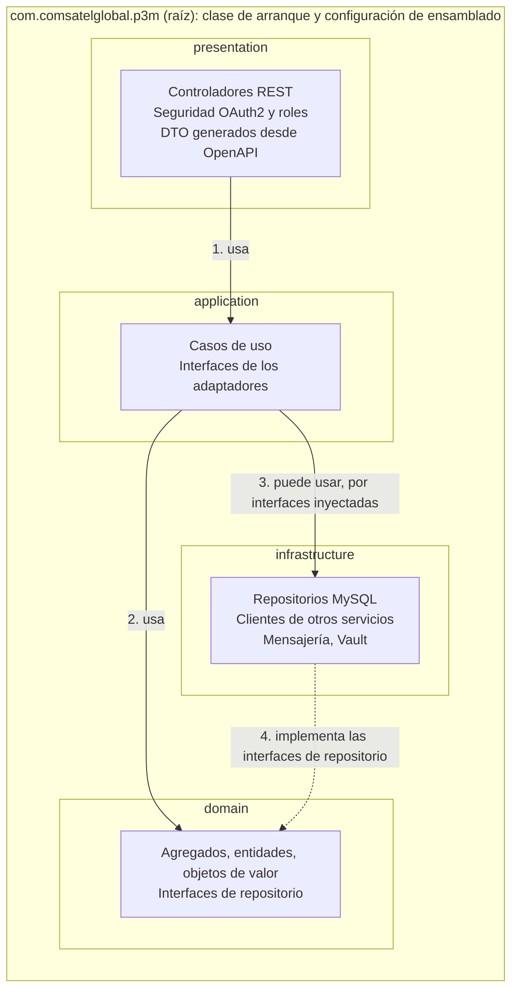
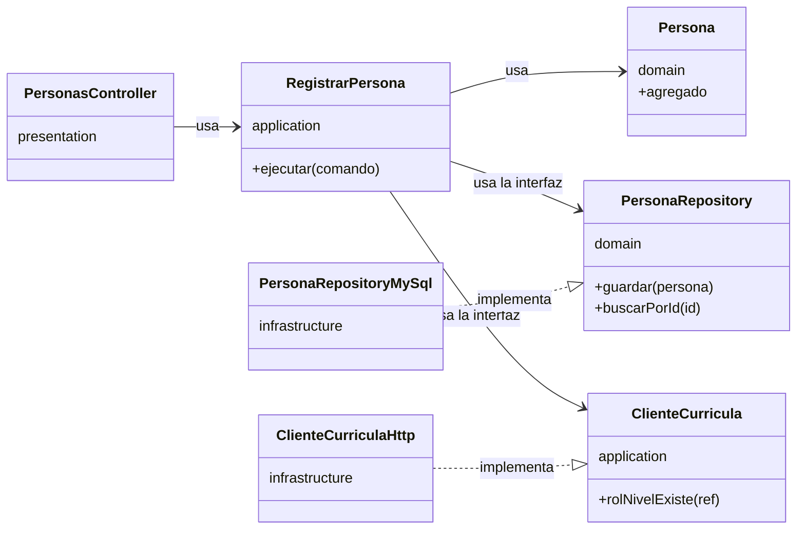
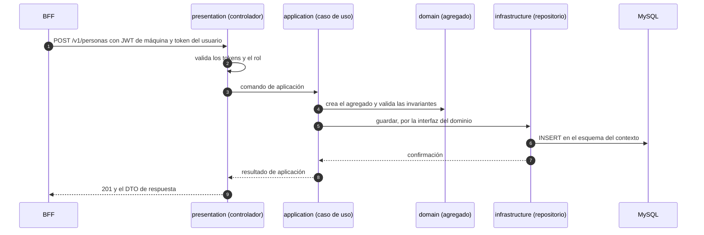

# ADR-17 — Arquitectura hexagonal y paquetes de los microservicios

## 1. Estado

**Decisión declarada por el responsable (ianache) el 2026-10-13, en sesión; el mismo día respondió A-1 a A-5 (ver las preguntas abiertas).** No consta la revisión de un arquitecto distinto. `draft`: falta su aprobación formal. Complementa a [ADR-16](ADR-16-microservicios-en-java-24-con-spring-boot-y-spring-cloud.md) y desarrolla lo que [ADR-DB-002](ADR-DB-002.md) ya declaraba («fronteras hexagonales») y DDM-001 §6 («puertos y adaptadores»).

## 2. Contexto

Los microservicios de dominio (ADR-P2) se construyen en Java con Spring (ADR-16). El responsable fijó cómo se organiza el código y qué dependencias se permiten, para que el dominio no dependa de la tecnología y la estructura sea comprobable.

## 3. Decisión

### 3.1 Paquetes

Todo el código de un microservicio vive bajo el paquete principal **`com.comsatelglobal.p3m`**, organizado lógicamente en cuatro paquetes:

| Paquete | Contiene |
|---|---|
| `com.comsatelglobal.p3m.presentation` | Todas las clases que implementan la **interfaz del API RESTful** |
| `com.comsatelglobal.p3m.application` | Todos los **casos de uso** de las funcionalidades del microservicio |
| `com.comsatelglobal.p3m.domain` | Todas las clases **propias del dominio**; definen el core del microservicio **sin detalles técnicos de tecnología**, pues representan la esencia del negocio |
| `com.comsatelglobal.p3m.infrastructure` | Todas las clases que implementan **todo aspecto de la infraestructura base** que soporta al microservicio (conexión a la base de datos, implementación de los repositorios, etc.) |

### 3.2 Reglas de dependencia (estrictas)

1. `presentation` **usa** `application`.
2. `application` **usa** `domain`.
3. `application` **puede usar** `infrastructure`.
4. `domain` **solo usa**, por **inversión de control**, las implementaciones de las interfaces de repositorio que están en `infrastructure`.

Las reglas son **estrictas**: lo que no está permitido arriba está prohibido. Matriz resultante:

| Desde \ Hacia | `presentation` | `application` | `domain` | `infrastructure` |
|---|---|---|---|---|
| **`presentation`** | — | ✔ regla 1 | ✘ | ✘ |
| **`application`** | ✘ | — | ✔ regla 2 | ✔ regla 3 (puede) |
| **`domain`** | ✘ | ✘ | — | solo por inversión de control (regla 4): **no importa clases** de `infrastructure` |
| **`infrastructure`** | ✘ (I) | ✘ (I) | ✔ (I) implementa las interfaces de repositorio del dominio | — |

**(I) = inferido** de la regla 4: si el dominio usa implementaciones por inversión de control, las **interfaces de repositorio las define el dominio** y `infrastructure` las implementa (por eso `infrastructure` depende de `domain`). Que `infrastructure` no dependa de `presentation` ni de `application` también se infiere de que las reglas son estrictas.

### 3.3 Cómo se lee la regla 4
- El `domain` declara las **interfaces de repositorio** (puertos de salida).
- `infrastructure` las implementa (con la base de datos MySQL, ADR-05).
- Quien las inyecta es el contenedor de inversión de control; `domain` nunca construye ni conoce la implementación.
- El `domain` **no lleva anotaciones ni clases de Spring, de persistencia ni de otros marcos** («sin detalles técnicos»).

### 3.4 Diagramas

#### Dependencias permitidas entre los paquetes

Las flechas continuas son dependencias permitidas (reglas 1 a 3). La flecha de puntos es la inversión de control de la regla 4: `infrastructure` **implementa** las interfaces de repositorio que declara `domain`, y el dominio nunca importa clases de `infrastructure`. Cualquier otra dependencia entre los cuatro paquetes está prohibida. El paquete raíz ensambla las cuatro capas y ninguna capa depende de él.



#### Inversión de control: un caso de uso concreto

El caso de uso depende de **interfaces**. Una de ellas la declara `domain` (el repositorio) y otra `application` (el cliente de otro servicio). Las implementaciones están en `infrastructure` y se inyectan al arrancar.



#### Recorrido de una solicitud

El BFF llama al servicio con el JWT de máquina y el token del usuario (ADR-P9, ADR-P5). La seguridad se resuelve en `presentation` (A-2).



#### Estructura de paquetes de un servicio con dos contextos

Ejemplo de `svc-partes-identidad` (contextos `partes` e `identidad`, A-4). La clase de arranque y el ensamblado están en la raíz (A-1).

```text
com.comsatelglobal.p3m
├── P3mPartesIdentidadApplication      (arranque)  y la configuración de ensamblado
├── presentation
│   ├── partes
│   └── identidad
├── application
│   ├── partes
│   └── identidad
├── domain
│   ├── partes
│   └── identidad
└── infrastructure
    ├── partes
    └── identidad
```

## 4. Alternativas consideradas

No constan en las fuentes. No se inventaron. (ADR-DB-002 ya declaraba las fronteras hexagonales.)

## 5. Consecuencias

Lo que se deduce, **sin decidirlo todavía**:

| Tema | Consecuencia |
|---|---|
| Modelos de persistencia | Si `domain` no puede llevar anotaciones de persistencia, las entidades de la base de datos (por ejemplo JPA) viven en `infrastructure` y un **mapeador** las convierte al modelo de dominio |
| DTO del API | `presentation` define sus propios DTO; `presentation` **no usa `domain`**, así que los casos de uso de `application` devuelven resultados propios de `application` (no objetos de dominio) y `presentation` los traduce |
| Transacciones | Un caso de uso es la frontera transaccional (por ejemplo `@Transactional` en `application`) |
| Anotaciones de Spring | `application` e `infrastructure` pueden usar Spring; el ensamblado de los objetos de dominio se hace fuera de `domain` |
| Puertos y adaptadores | **Decidido (A-3):** `application` **usa interfaces**, y las implementaciones (en `infrastructure`) se **inyectan**. Las interfaces de repositorio están en `domain` (regla 4); las de los demás adaptadores (clientes HTTP hacia otros servicios, mensajería, Vault, GitLab) las define `application`. Cuando `presentation` necesite algo que implementa `infrastructure`, también es **por interfaz inyectada**, nunca importando clases de `infrastructure`. Esto precisa la regla 3: `application` usa `infrastructure` a través de interfaces |
| Un servicio con varios contextos | **Decidido (A-4):** subpaquete por contexto **dentro de cada capa** (`...domain.partes`, `...domain.identidad`, `...application.partes`...) y **ningún import entre contextos** (ADR-DB-002) |
| Comprobación | **Decidido (A-5): obligatoria.** Pruebas de arquitectura con **ArchUnit** (última estable 1.5.1) en el build de cada servicio y en el pipeline: fallan si se rompe la matriz, si `domain` importa `org.springframework..` o `jakarta.persistence..`, si hay imports entre contextos y si `presentation` o `domain` importan clases de `infrastructure` |
| Clase de arranque y configuración | **Decidido (A-1):** la clase `@SpringBootApplication` y la **configuración de ensamblado** viven en el paquete raíz `com.comsatelglobal.p3m`, fuera de las cuatro capas. El paquete raíz **puede depender de las cuatro capas** (es quien las ensambla); **ninguna capa puede depender del paquete raíz**. Las pruebas ArchUnit lo reflejan |

### Preguntas abiertas
| ID | Pregunta | Dueño |
|---|---|---|
| ~~A-1~~ | **Resuelta (ianache, 2026-10-13):** la clase de arranque y la configuración de ensamblado van en `com.comsatelglobal.p3m` | — |
| ~~A-2~~ | **Resuelta (ianache, 2026-10-13): la seguridad (servidor de recursos OAuth2, filtros de token y de rol) va en `presentation`** | — |
| ~~A-3~~ | **Resuelta (ianache, 2026-10-13):** `application` usa interfaces y se inyectan las implementaciones; lo mismo cuando `presentation` necesita algo de `infrastructure`. **Por confirmar:** dónde se declaran las interfaces que `presentation` consume de `infrastructure` (se asume `application`, para que `presentation` solo dependa de `application`) | — |
| ~~A-4~~ | **Resuelta (ianache, 2026-10-13): sí** a los subpaquetes por contexto | — |
| ~~A-5~~ | **Resuelta (ianache, 2026-10-13): sí**, las pruebas ArchUnit son obligatorias en el pipeline | — |
| A-6 | **API primero (contrato primero):** ianache pidió considerar un **plugin que convierta la especificación del API (Swagger/OpenAPI) en las clases Java derivadas**. Ver el apartado siguiente. ¿Se adopta, con qué generador y dónde vive la especificación? | Arquitectura |

### API primero: generación de las clases del API desde la especificación (a considerar, A-6)

El responsable pidió **considerar un plugin** que genere, desde la especificación del API en OpenAPI (Swagger), las clases Java correspondientes. Es coherente con ADR-17 y con el flujo de diseño de API del proyecto (el contrato OpenAPI lo redactan `api-designer` y sus revisores).

| Aspecto | Propuesta (I) |
|---|---|
| Qué se genera | **Interfaces del API y DTO** en `com.comsatelglobal.p3m.presentation` (por ejemplo `presentation.api` y `presentation.model`). Los controladores **implementan** las interfaces generadas. Esto encaja con la regla 1: `presentation` solo conoce `application` |
| Herramienta candidata | **OpenAPI Generator**, generador `spring`, en modo de solo interfaces. Última estable verificada en Maven Central (2026-10-13): plugin de Maven **7.26.0** y plugin de Gradle **7.14.0** (el de Gradle va **rezagado**: un punto a favor de Maven en J-3 de ADR-16) |
| Riesgo a verificar | Que el generador **soporte Spring Boot 4 (Spring Framework 7 y Jackson 3)**: no está comprobado. Hay que probar un servicio antes de adoptarlo. Alternativa: escribir las interfaces a mano y validarlas contra el contrato en las pruebas de contrato |
| Dónde vive la especificación | En el repositorio de cada servicio (por ejemplo `src/main/resources/openapi/`), copiada desde el contrato revisado de la base de conocimiento. **Pregunta:** ¿cuál es la fuente de verdad, el repositorio del servicio o la base de conocimiento? |
| Código generado | No se versiona: se genera en cada construcción (`target/generated-sources`). Las pruebas ArchUnit lo incluyen o lo excluyen explícitamente |
| Documentación | La especificación es la fuente del API: springdoc-openapi (última 3.1.1) pasaría a ser solo una verificación de que el código coincide con el contrato |


## 6. Requisitos a los que responde

[ASR-10](../asr/asr-10.md) (integridad entre contextos), [ASR-16](../asr/asr-16.md). Relacionado con ADR-DB-002 y DDM-001 §6.

## 7. Fuente

Declaración de ianache, 2026-10-13.

## 8. Preparación

- **Estado:** `draft`. La decisión la declaró el responsable. Ningún arquitecto la revisó.
- **Catálogo:** [CAT-ADR-001](../CAT-ADR-001-decisiones-de-arquitectura.md).
