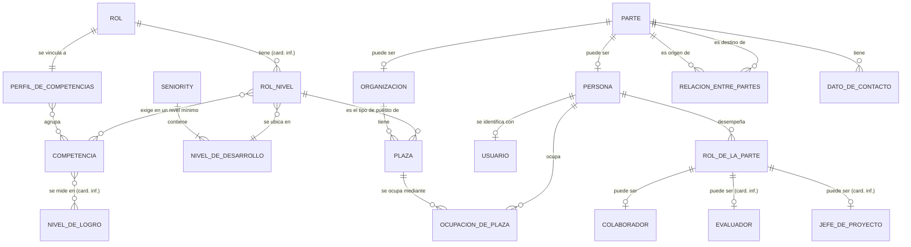
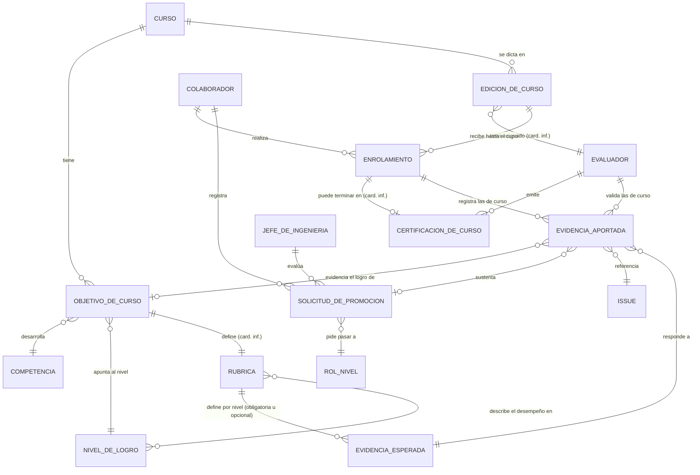
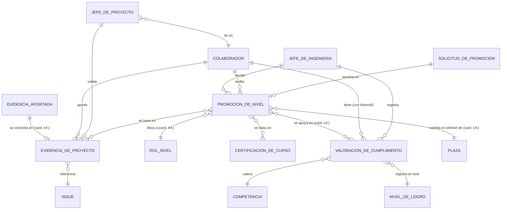
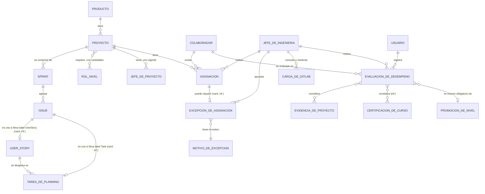

# IMD-001 — Modelo de información conceptual del P3M

> **Qué es y qué no es:** es un modelo **conceptual**. Muestra qué conceptos de negocio existen y cómo se relacionan. **No** es un modelo de datos: no define tablas, atributos técnicos, identificadores ni persistencia (eso corresponde a `data-model-designer`).
>
> **Procedencia:** el catálogo de reglas [BRC-001](../rules/BRC-001-reglas-de-negocio-portal-curricula.md), el glosario [GLS-001](../glossary/GLS-001-glosario-de-negocio.md) y el Requirement Context Pack RCP-001, todos en estado `draft`. En los diagramas, las relaciones marcadas **(inf.)** son inferencias y las marcadas **(card. inf.)** tienen la cardinalidad inferida. El detalle de cada relación está en la sección 5.

## 1. Vista general

El modelo tiene cuatro bloques y, dentro de **Roles y competencias**, un núcleo alineado con Party Management del UDM: la parte (persona u organización), su rol, sus relaciones con vigencia, sus datos de contacto y su usuario (sección 5.1). **Roles y competencias:** un rol tiene un perfil de competencias, y cada combinación rol/nivel exige un nivel mínimo de logro en cada competencia. **Cursos y evidencias:** un curso, con ediciones y objetivos vinculados a competencias, define evidencias esperadas (obligatorias o deseables). Los colaboradores enrolados aportan evidencias, que el Evaluador valida, y obtienen una certificación de curso, que es lo mismo que la promoción en el curso. **Progresión:** el Jefe de Ingeniería registra la valoración del nivel actual de cada competencia de un colaborador, con historial, y con ella, con las certificaciones de curso y con las evidencias de proyecto decide la promoción de nivel o seniority. **Portafolio y asignación:** un producto tiene proyectos, que son conjuntos de milestones de GitLab, y los colaboradores se asignan a proyectos verificando su nivel mínimo, con excepciones aprobadas por el Jefe de Ingeniería.

**Términos del glosario que no son conceptos del modelo:** Nivel mínimo de competencia (calificador de R-07), Cupo (atributo de la edición), Evidencia obligatoria y Evidencia deseable (calificadores de R-21), Estado de evidencia (atributo de la evidencia aportada), ADMIN (permiso), y Portal, GitLab, Keycloak e IdM (sistemas).

## 2. Diagramas — roles, competencias y cursos

### 2.1 Roles, niveles y competencias

### 2.2 Cursos, ediciones y evidencias

**Conceptos derivados** (se calculan o se muestran, no se registran):
- Brecha de cumplimiento: diferencia entre el nivel actual de una competencia (valoración) y el nivel mínimo del siguiente rol/nivel (BR-052).

## 3. Diagramas — progresión, portafolio y asignación

Los conceptos **externos** viven en GitLab: ISSUE, USER_STORY, TAREA_DE_PLANNING y SPRINT (milestone). El portal los muestra en solo lectura, consultados de forma automática cada 30 segundos por defecto (BR-036, BR-037, BR-039).

### 3.1 Progresión

### 3.2 Portafolio y asignación

## 4. Conceptos

| Concepto | Nombre en diagrama | Qué es | Bloque | Glosario | Fuente | Horizonte |
|---|---|---|---|---|---|---|
| Colaborador | COLABORADOR | Persona del Área de Desarrollo, en el rol de colaborador, registrada en el portal, con un único rol/nivel vigente. | Roles y competencias | [TRM-0002](../glossary/terms/TRM-0002-colaborador.md) | BR-002, BR-005, BR-047, BR-077 | Por definir |
| Organización | ORGANIZACION | Parte que es una entidad: COMSATEL, el Área de Desarrollo o un proveedor. Se registra con Tax ID, razón social (Business Name) y nombre comercial (Commercial Name), y se puede inactivar. | Roles y competencias | [TRM-0050](../glossary/terms/TRM-0050-organizacion.md) | BR-072, BR-136, BR-137 | Por definir |
| Parte | PARTE | Persona u organización que el P3M registra y con la que se relaciona. | Roles y competencias | [TRM-0059](../glossary/terms/TRM-0059-parte.md) | D-129 | Por definir |
| Persona | PERSONA | Parte que es un individuo, con nombres y apellidos. | Roles y competencias | [TRM-0060](../glossary/terms/TRM-0060-persona.md) | BR-002, BR-070 | Por definir |
| Rol de la parte | ROL_DE_LA_PARTE | Función que una parte desempeña durante un periodo: colaborador, jefe de proyecto, instructor. | Roles y competencias | [TRM-0061](../glossary/terms/TRM-0061-rol-de-la-parte.md) | BR-063, BR-079 | Por definir |
| Relación entre partes | RELACION_ENTRE_PARTES | Vínculo con vigencia entre dos partes, de un tipo: reporta a, membership o es parte de. | Roles y competencias | [TRM-0062](../glossary/terms/TRM-0062-relacion-entre-partes.md) | BR-071, BR-072, BR-076 | Por definir |
| Plaza | PLAZA | Puesto concreto de una organización, de un rol/nivel, que un colaborador ocupa durante un periodo. La ocupa un solo colaborador a la vez; su rol/nivel cambia con la promoción y se conserva el historial (BR-106, BR-110). | Roles y competencias | [TRM-0063](../glossary/terms/TRM-0063-plaza.md) | BR-097 | Por definir |
| Ocupación de plaza | OCUPACION_DE_PLAZA | Periodo, con desde y hasta, en que una persona ocupa una plaza. Da el rol/nivel vigente y el historial de cambios de nivel y seniority. | Roles y competencias | [TRM-0064](../glossary/terms/TRM-0064-ocupacion-de-plaza.md) | BR-047, BR-079, BR-097 | Por definir |
| Dato de contacto | DATO_DE_CONTACTO | Correo, teléfono o dirección de una parte (persona u organización). Toda parte tiene datos de contacto (BR-131). Un contacto no se borra: se da de baja con fecha y responsable (BR-130). | Roles y competencias | [TRM-0051](../glossary/terms/TRM-0051-dato-de-contacto.md) | BR-070, BR-131 a BR-133 | Por definir |
| Usuario | USUARIO | Identidad con la que una persona (siempre, si es colaborador) ingresa al portal. Se registra al iniciar sesión con GUID de Keycloak, username, correo y roles de usuario. Se vincula con su persona por el correo la primera vez (BR-125) y ese vínculo se fija una sola vez (BR-129). No hay registro libre de cuentas (BR-128). | Roles y competencias | [TRM-0052](../glossary/terms/TRM-0052-usuario.md) | BR-074, BR-075, BR-077 | Por definir |
| Rol | ROL | Función del catálogo oficial de roles, que se vincula a un perfil de competencias. | Roles y competencias | [TRM-0003](../glossary/terms/TRM-0003-rol.md) | BR-001, BR-012 | Por definir |
| Rol/nivel | ROL_NIVEL | Tipo de puesto: combinación de un rol con un nivel de desarrollo (por ejemplo Developer, Junior, Nivel 2). Determina el perfil exigido y los roles que requiere un proyecto. | Roles y competencias | [TRM-0006](../glossary/terms/TRM-0006-rol-nivel.md) | BR-014, BR-040, BR-047, BR-097 | Por definir |
| Seniority | SENIORITY | Categoría Junior, Semisenior o Senior que contiene los niveles de desarrollo L1 a L4. | Roles y competencias | [TRM-0004](../glossary/terms/TRM-0004-seniority.md) | BR-011 | Por definir |
| Nivel de desarrollo (L1–L4) | NIVEL_DE_DESARROLLO | Nivel L1 a L4 dentro de un seniority, por ejemplo Junior L2. | Roles y competencias | [TRM-0005](../glossary/terms/TRM-0005-nivel-de-desarrollo-l1-l4.md) | BR-011, BR-031 | Por definir |
| Perfil de competencias | PERFIL_DE_COMPETENCIAS | Conjunto de competencias de un rol. | Roles y competencias | [TRM-0010](../glossary/terms/TRM-0010-perfil-de-competencias.md) | BR-012 | Por definir |
| Competencia | COMPETENCIA | Lo esperado de un rol/nivel, con código, nombre, tipo único (conocimiento, habilidad o actitud) y definición de cada nivel de logro. Tiene un indicador que define si es general o específica. Una competencia general puede estar en varios perfiles. | Roles y competencias | [TRM-0007](../glossary/terms/TRM-0007-competencia.md) | BR-012, BR-056, BR-059, BR-060 | Por definir |
| Nivel de logro (N1–N3) | NIVEL_DE_LOGRO | Escala N1 no desarrollada, N2 en desarrollo, N3 desarrollada con la que se mide una competencia. | Roles y competencias | [TRM-0008](../glossary/terms/TRM-0008-nivel-de-logro-n1-n3.md) | BR-013 | Por definir |
| Curso | CURSO | Actividad de entrenamiento interna con objetivos y ediciones. Puede desarrollar varias competencias. | Cursos y evidencias | [TRM-0011](../glossary/terms/TRM-0011-curso.md) | BR-016, BR-017 | Por definir |
| Objetivo de curso | OBJETIVO_DE_CURSO | Meta de un curso vinculada a una competencia y a un nivel objetivo. | Cursos y evidencias | [TRM-0012](../glossary/terms/TRM-0012-objetivo-de-curso.md) | BR-017 | Por definir |
| Edición de curso | EDICION_DE_CURSO | Realización de un curso, con número, fechas, cupo e instructor. | Cursos y evidencias | [TRM-0013](../glossary/terms/TRM-0013-edicion-de-curso.md) | BR-024 | Por definir |
| Evaluador | EVALUADOR | Instructor de una edición que valida evidencias de curso y emite la certificación. Es un rol de la parte con vigencia (BR-108). | Cursos y evidencias | [TRM-0016](../glossary/terms/TRM-0016-evaluador.md) | BR-008, BR-009 | Por definir |
| Enrolamiento | ENROLAMIENTO | Inscripción de un colaborador en una edición, donde se registran avance, evaluación y certificado. El avance es un porcentaje, la evaluación es una nota de 0 a 20 (una nota de 12 o más es solo informativa) y se registran comentarios (BR-123, BR-126). Quien se desenrola puede volver a enrolarse (BR-122). | Cursos y evidencias | [TRM-0015](../glossary/terms/TRM-0015-enrolamiento.md) | BR-023, BR-025 | Por definir |
| Evidencia | — (término general; ver EVIDENCIA_ESPERADA y EVIDENCIA_APORTADA) | Prueba del logro de una competencia. El modelo distingue la requerida de la aportada. | Cursos y evidencias | [TRM-0017](../glossary/terms/TRM-0017-evidencia.md) | BR-054 | Por definir |
| Evidencia esperada | EVIDENCIA_ESPERADA | Evidencia que el curso o la competencia define para sustentar el logro, obligatoria o deseable. Tiene una descripción (BR-119). | Cursos y evidencias | [TRM-0040](../glossary/terms/TRM-0040-evidencia-esperada.md) | BR-015, BR-018, BR-054 | Por definir |
| Evidencia aportada | EVIDENCIA_APORTADA | Referencia a un issue de GitLab cerrado que un colaborador registra como evidencia del logro de un objetivo, con estado Pendiente o Validada. Es una URL de GitLab; por cada evidencia esperada y enrolamiento hay una sola, reemplazable mientras esté Pendiente (BR-103, BR-104, BR-105). | Cursos y evidencias | [TRM-0041](../glossary/terms/TRM-0041-evidencia-aportada.md) | BR-019, BR-054, BR-059 | Por definir |
| Evidencia de proyecto | EVIDENCIA_DE_PROYECTO | Evidencia aportada que referencia un issue de GitLab cerrado. Se liga solo por la URL del issue (BR-114). | Progresión | [TRM-0018](../glossary/terms/TRM-0018-evidencia-de-proyecto.md) | BR-020, BR-028 | Por definir |
| Certificación de curso | CERTIFICACION_DE_CURSO | Reconocimiento por edición cuando las evidencias obligatorias están Validadas. Es el mismo resultado que la promoción en el curso. No es una evidencia aportada: es un resultado emitido por el Evaluador (BR-103, BR-104). | Cursos y evidencias | [TRM-0022](../glossary/terms/TRM-0022-certificacion-de-curso.md) | BR-021, BR-022 | Por definir |
| Promoción en el curso | — (mismo concepto que CERTIFICACION_DE_CURSO) | Otro nombre del resultado que el Evaluador otorga en el curso. Se modela como un solo concepto. | Cursos y evidencias | [TRM-0023](../glossary/terms/TRM-0023-promocion-en-el-curso.md) | BR-022 | Por definir |
| Promoción de nivel | PROMOCION_DE_NIVEL | Decisión del Jefe de Ingeniería de pasar al colaborador al siguiente nivel o seniority. | Progresión | [TRM-0024](../glossary/terms/TRM-0024-promocion-de-nivel.md) | BR-007, BR-029 | Por definir |
| Solicitud de promoción | SOLICITUD_DE_PROMOCION | Petición del colaborador para pasar a un nuevo rol/nivel, con las evidencias que la sustentan. La evalúa el Jefe de Ingeniería. Estados: registrada, evaluada y decidida (BR-111 a BR-113). | Progresión | [TRM-0048](../glossary/terms/TRM-0048-solicitud-de-promocion.md) | BR-064, BR-068 | Por definir |
| Evaluación de desempeño | EVALUACION_DE_DESEMPENO | Evaluación semestral (o a demanda) del Jefe de Ingeniería sobre un colaborador, con resultado supera, cumple, parcial o no cumple, periodo, comentarios, evidencias consideradas, fecha y hora y usuario que la registra. Se conserva su historial. Es obligatoria para promover. | Progresión | [TRM-0053](../glossary/terms/TRM-0053-evaluacion-de-desempeno.md) | BR-083 a BR-089 | Por definir |
| Valoración de cumplimiento | VALORACION_DE_CUMPLIMIENTO | Registro del nivel actual de una competencia de un colaborador, con historial. | Progresión | [TRM-0025](../glossary/terms/TRM-0025-valoracion-de-cumplimiento.md) | BR-004, BR-051 | Por definir |
| Brecha de cumplimiento | — (derivado) | Diferencia entre el nivel actual del colaborador y el nivel mínimo del siguiente rol/nivel. Se muestra, no se registra. | Progresión | [TRM-0042](../glossary/terms/TRM-0042-brecha-de-cumplimiento.md) | BR-052 | Por definir |
| Jefe de Ingeniería | JEFE_DE_INGENIERIA | Responsable funcional que asigna, aprueba excepciones, registra valoraciones y decide promociones. | Progresión y asignación | [TRM-0026](../glossary/terms/TRM-0026-jefe-de-ingenieria.md) | BR-005, BR-006, BR-007 | Por definir |
| Jefe de proyecto | JEFE_DE_PROYECTO | Colaborador asignado a un proyecto que valida las evidencias de proyecto. Es un rol de la parte con vigencia; un proyecto tiene uno vigente (BR-102, BR-108). | Progresión | [TRM-0027](../glossary/terms/TRM-0027-jefe-de-proyecto.md) | BR-010 | Por definir |
| Producto | PRODUCTO | Software que desarrollan los colaboradores, con código, nombre y proyecto de GitLab. | Portafolio y asignación | [TRM-0029](../glossary/terms/TRM-0029-producto.md) | BR-032 | Por definir |
| Proyecto | PROYECTO | Trabajo de un solo producto, con estimaciones. Es un conjunto de milestones. El costo se expresa en soles peruanos y el esfuerzo en horas-persona (BR-127). | Portafolio y asignación | [TRM-0030](../glossary/terms/TRM-0030-proyecto.md) | BR-033, BR-034, BR-048 | Por definir |
| Sprint | SPRINT | Unidad de organización de un proyecto. Equivale a un milestone de GitLab (concepto externo). | Portafolio y asignación | [TRM-0031](../glossary/terms/TRM-0031-sprint.md) | BR-035, BR-036, BR-049 | Por definir |
| Issue de GitLab | ISSUE | Elemento de trabajo de GitLab: user story o tarea (concepto externo). | Portafolio y asignación | [TRM-0032](../glossary/terms/TRM-0032-issue-de-gitlab.md) | BR-020, BR-038, BR-050 | Por definir |
| User story | USER_STORY | Issue de GitLab con label UserStory (concepto externo). | Portafolio y asignación | [TRM-0033](../glossary/terms/TRM-0033-user-story.md) | BR-036 | Por definir |
| Tarea de planning | TAREA_DE_PLANNING | Issue de GitLab con label Task vinculado a una user story durante el sprint planning (concepto externo). | Portafolio y asignación | [TRM-0043](../glossary/terms/TRM-0043-tarea-de-planning.md) | BR-050 | Por definir |
| Asignación | ASIGNACION | Vínculo de un colaborador con un proyecto según el rol/nivel requerido. Un colaborador puede tener varias. Tiene vigencia (desde y hasta), un porcentaje de dedicación (la suma de un colaborador no supera 100 %) e historial. Estados: pendiente (hasta la excepción), vigente y finalizada (BR-111 a BR-113). | Portafolio y asignación | [TRM-0034](../glossary/terms/TRM-0034-asignacion.md) | BR-040, BR-041, BR-045, BR-078, BR-080, BR-093 | Por definir |
| Excepción de asignación | EXCEPCION_DE_ASIGNACION | Aprobación del Jefe de Ingeniería para asignar a quien no alcanza el nivel mínimo. | Portafolio y asignación | [TRM-0035](../glossary/terms/TRM-0035-excepcion-de-asignacion.md) | BR-006, BR-042 | Por definir |
| Carga automática de GitLab | CARGA_DE_GITLAB | Ejecución programada que trae de GitLab lo creado o actualizado desde la ejecución anterior, con fecha y hora y estado. Se reintenta 3 veces con esperas incrementales y circuit breaker. Sus logs se retienen por siempre. La primera carga es completa. Estados: programada, ejecutando, completada, fallida o sin cambios (BR-111 a BR-113). | Portafolio y asignación | [TRM-0047](../glossary/terms/TRM-0047-carga-automatica-de-gitlab.md) | BR-039, BR-065, BR-066, BR-082, BR-090, BR-092, BR-094 | Por definir |
| Motivo de excepción | MOTIVO_DE_EXCEPCION | Código y descripción de un codificador prestablecido, con funcionalidad propia de mantenimiento. | Portafolio y asignación | [TRM-0039](../glossary/terms/TRM-0039-motivo-de-excepcion.md) | BR-043, BR-053 | Por definir |
| Rúbrica | RUBRICA | Descriptor de un objetivo de curso: define los niveles de logro de la competencia y, por nivel, el desempeño observable y las evidencias requeridas, obligatorias u opcionales. | Cursos y evidencias | [TRM-0045](../glossary/terms/TRM-0045-rubrica.md) | BR-058 | Por definir |

## 5. Relaciones

Clasificación: **FACT** (lo dice la fuente), **INFERENCE** (deducción razonada desde fuentes citadas), **UNKNOWN** (necesario pero sin respaldo) y **RETIRADA** (ya no aplica, con motivo).

| ID | Relación | Cardinalidad | Clasificación | Fuente | Pregunta |
|---|---|---|---|---|---|
| R-01 | Un rol se vincula a un perfil de competencias | 1 : 1 | FACT (BR-012, BR-115) | BR-012, BR-115 | IM-Q9 (cerrada) |
| R-02 | Un perfil de competencias agrupa competencias (una competencia general puede estar en varios perfiles) | N : M | FACT (EVD-2026-0089) | BR-012, BR-060 | — |
| R-03 | Una competencia se mide en los niveles de logro N1, N2 y N3 | N : M (la escala es común: cada competencia usa los tres niveles) | FACT para la relación; INFERENCE para la cardinalidad | BR-012, BR-013 | — |
| R-04 | Un seniority contiene los niveles de desarrollo L1 a L4 | 1 : N (cuatro niveles por seniority) | FACT | BR-011, BR-116 | IM-Q6 (cerrada) |
| R-05 | Un rol tiene niveles (rol/nivel) | 1 : N | FACT para la relación; INFERENCE para la cardinalidad | BR-014 | — |
| R-06 | Un rol/nivel se ubica en un nivel de desarrollo de un seniority | N : 1 | FACT (BR-011, BR-116) | BR-011, BR-014, BR-116 | IM-Q6 (cerrada) |
| R-07 | Un rol/nivel exige de cada competencia de su perfil un nivel mínimo de logro (calificador) | N : M | FACT | BR-014 | — |
| R-08 | Un colaborador ocupa un rol/nivel y se conserva el historial de cambios de nivel y seniority | N : 1 vigente; N : M en el tiempo | RETIRADA: reemplazada por R-84 a R-87 (el colaborador ocupa una plaza de un rol/nivel, D-130 y D-131). Antes: FACT (un solo rol/nivel vigente, EVD-2026-0070; historial, EVD-2026-0115) | BR-002, BR-047, BR-079 | — |
| R-09 | Un curso tiene objetivos | 1 : N (el mínimo es UNKNOWN) | FACT | BR-017 | — |
| R-10 | Un objetivo de curso desarrolla una competencia | N : 1 | FACT | BR-017 | — |
| R-11 | Un objetivo de curso apunta a un nivel de logro objetivo | N : 1 | FACT | BR-017 | — |
| R-12 | Un curso se dicta en ediciones | 1 : N | FACT | BR-024 | — |
| R-13 | Una edición tiene un instructor asignado, que actúa como Evaluador | N : 1 | FACT para la relación; INFERENCE para la cardinalidad | BR-008, BR-024 | — |
| R-14 | Un colaborador realiza enrolamientos | 1 : N | FACT | BR-025 | — |
| R-15 | Una edición recibe enrolamientos, hasta su cupo | 1 : N | FACT | BR-024, BR-026 | — |
| R-16 | Un enrolamiento puede terminar en una certificación de curso (equivale a la promoción en el curso) | 1 : 0..1 | FACT para la relación; INFERENCE para la cardinalidad | BR-021, BR-022, BR-023 | — |
| R-17 | Un enrolamiento puede terminar en una promoción en el curso | — | RETIRADA: la promoción en el curso es el mismo resultado que la certificación (EVD-2026-0074); se modela en R-16 | BR-022 | — |
| R-18 | El Evaluador otorga promociones en el curso | — | RETIRADA: fusionada con R-19 por la misma razón que R-17 | BR-009, BR-022 | — |
| R-19 | El Evaluador emite certificaciones de curso (promociones en el curso) | 1 : N | FACT | BR-009, BR-022 | — |
| R-20 | El Evaluador valida evidencias aportadas de curso | 1 : N | FACT | BR-009 | — |
| R-21 | Una rúbrica define las evidencias esperadas por nivel de logro, obligatorias u opcionales (calificador) | 1 : N | FACT | BR-018, BR-058 | — |
| R-22 | Una competencia define las evidencias esperadas que la sustentan | — | RETIRADA: las evidencias se definen en la rúbrica y no en la competencia (EVD-2026-0087); se modela en R-21 | BR-015 | — |
| R-23 | Una evidencia de proyecto es un tipo de evidencia aportada | 1 : 0..1 | FACT para la relación (EVD-2026-0045); INFERENCE para la cardinalidad | BR-019, BR-020 | — |
| R-24 | Una certificación de curso puede ser una evidencia aportada | — | RETIRADA: la certificación es un resultado emitido por el Evaluador, no una evidencia aportada (BR-103, BR-104, IM-Q10 cerrada). Antes: INFERENCE | BR-021, BR-103, BR-104 | — |
| R-25 | Un colaborador aporta evidencias de proyecto | 1 : N | FACT | BR-028 | — |
| R-26 | Una evidencia de proyecto referencia un issue de GitLab | N : 1 | FACT | BR-020 | — |
| R-27 | El jefe de proyecto valida evidencias de proyecto | 1 : N | FACT | BR-010 | — |
| R-28 | El Jefe de Ingeniería decide promociones de nivel | 1 : N | FACT | BR-007 | — |
| R-29 | Un colaborador recibe promociones de nivel | 1 : N | FACT | BR-029 | — |
| R-30 | Una promoción de nivel lleva a un rol/nivel siguiente | N : 1 | FACT para la relación; INFERENCE para la cardinalidad | BR-029, BR-031 | — |
| R-31 | Una promoción de nivel se basa en certificaciones de curso (promociones en el curso) | N : M | FACT | BR-030 | — |
| R-32 | Una promoción de nivel toma los resultados de promoción en el curso | — | RETIRADA: fusionada con R-31 (EVD-2026-0074) | BR-030 | — |
| R-33 | Una promoción de nivel se basa en evidencias de proyecto | N : M | FACT | BR-030 | — |
| R-34 | Una promoción de nivel se apoya en valoraciones de cumplimiento | N : M | FACT (EVD-2026-0053, EVD-2026-0073); cardinalidad INFERENCE | BR-004, BR-029, BR-051 | — |
| R-35 | Un producto tiene proyectos | 1 : N | FACT (EVD-2026-0071) | BR-032, BR-048 | — |
| R-36 | Un proyecto se compone de sprints (milestones). Un milestone pertenece a un único proyecto | 1 : N | FACT (EVD-2026-0036, EVD-2026-0131) | BR-034, BR-035, BR-091 | — |
| R-37 | Un sprint agrupa issues de GitLab | 1 : N | FACT (EVD-2026-0072) | BR-049 | — |
| R-38 | Una user story es un issue de GitLab con label UserStory | 1 : 0..1 | FACT para la relación; INFERENCE para la cardinalidad | BR-020, BR-036 | — |
| R-39 | Un proyecto requiere roles/niveles, con cantidades (calificador), que define cualquier usuario con rol de usuario Jefe de Ingeniería o ADMIN | N : M | FACT para la relación y las cantidades (EVD-2026-0066). Quién los define: BR-109, que contradice EVD-2026-0121 (los registra el jefe de proyecto designado); prevalece la decisión más reciente, por confirmar | BR-040, BR-046, BR-109 | IM-Q8 (cerrada); confirmar el permiso del jefe de proyecto |
| R-40 | Un colaborador recibe asignaciones | 1 : N | FACT (puede tener varias a la vez, EVD-2026-0067) | BR-040, BR-045 | — |
| R-41 | Un proyecto tiene asignaciones | 1 : N | FACT | BR-040 | — |
| R-42 | El Jefe de Ingeniería realiza asignaciones | 1 : N | FACT | BR-005 | — |
| R-43 | Una asignación puede requerir una excepción | 1 : 0..1 | FACT para la relación; INFERENCE para la cardinalidad | BR-042 | — |
| R-44 | El Jefe de Ingeniería aprueba excepciones de asignación | 1 : N | FACT | BR-006 | — |
| R-45 | Una excepción tiene un motivo del codificador | N : 1 | FACT | BR-043 | — |
| R-46 | Una evidencia aportada responde a una evidencia esperada. Por cada evidencia esperada y enrolamiento el colaborador registra una sola evidencia aportada, que puede reemplazar mientras esté Pendiente | N : 1 (una aportada por esperada y enrolamiento) | FACT (BR-103, BR-104, BR-105; EVD-2026-0076) | BR-054, BR-059 | — |
| R-47 | Un colaborador registra, en su enrolamiento, las evidencias aportadas de curso | 1 : N | FACT (EVD-2026-0080) | BR-059 | — |
| R-48 | Un colaborador tiene valoraciones de cumplimiento, con historial | 1 : N | FACT | BR-004, BR-051 | — |
| R-49 | Una valoración de cumplimiento valora una competencia | N : 1 | FACT | BR-004 | — |
| R-50 | Una valoración de cumplimiento registra un nivel de logro | N : 1 | FACT | BR-004 | — |
| R-51 | El Jefe de Ingeniería registra valoraciones de cumplimiento (también un ADMIN) | 1 : N | FACT | BR-004 | — |
| R-52 | Una user story se desglosa en tareas de planning | 1 : N | FACT | BR-050 | — |
| R-53 | Una tarea de planning es un issue de GitLab con label Task | 1 : 0..1 | FACT para la relación; INFERENCE para la cardinalidad | BR-050 | — |
| R-54 | Un jefe de proyecto es un colaborador | N : 1 | FACT (EVD-2026-0069) | BR-010 | — |
| R-55 | Un proyecto tiene jefes de proyecto a lo largo del tiempo, con vigencia desde y hasta; solo uno vigente a la vez. Un colaborador puede ser jefe de varios proyectos | 1 : N en el tiempo; 0..1 vigente | FACT (EVD-2026-0091, BR-102) | BR-010, BR-063 | — |
| R-56 | Un objetivo de curso define una rúbrica | 1 : 1 | FACT para la relación; INFERENCE para la cardinalidad | BR-058 | — |
| R-57 | Una rúbrica describe el desempeño observable en cada nivel de logro | N : M | FACT | BR-058 | — |
| R-58 | Una evidencia aportada de curso evidencia el logro de un objetivo de curso | N : 0..1 (una evidencia de solicitud de promoción no apunta a un objetivo) | FACT (EVD-2026-0080); INFERENCE para la cardinalidad | BR-059 | — |
| R-59 | Una evidencia aportada de curso referencia un issue de GitLab cerrado | N : 1 | FACT (EVD-2026-0080) | BR-020, BR-059 | — |
| R-60 | Una evidencia aportada puede sustentar una solicitud de promoción | N : 0..1 | FACT para la relación (EVD-2026-0090); INFERENCE para la cardinalidad | BR-064, BR-068 | — |
| R-61 | Un colaborador registra solicitudes de promoción | 1 : N | FACT para la relación (EVD-2026-0097); INFERENCE para la cardinalidad | BR-068 | — |
| R-62 | Una solicitud de promoción pide pasar a un rol/nivel | N : 1 | FACT (EVD-2026-0090) | BR-064 | — |
| R-63 | El Jefe de Ingeniería evalúa las solicitudes de promoción y valora todas sus evidencias | 1 : N | FACT (EVD-2026-0097) | BR-068 | — |
| R-64 | El Jefe de Ingeniería consulta las cargas de GitLab y puede reintentarlas (también un ADMIN) | 1 : N | FACT para la relación (EVD-2026-0094); INFERENCE para la cardinalidad | BR-066 | — |
| R-65 | Un colaborador reporta a otro colaborador, con vigencia | N : 0..1 | RETIRADA: reemplazada por R-80 y R-81 (relación entre partes de tipo «reporta a») (alineación con el UDM, D-129). Antes: FACT (EVD-2026-0100, EVD-2026-0105): un solo jefe y con vigencia | BR-071 | — |
| R-66 | Un colaborador tiene datos de contacto (correo, teléfono, dirección). Teléfono y correo son obligatorios | 1 : N | RETIRADA: reemplazada por R-82 (los datos de contacto pertenecen a la persona) (alineación con el UDM, D-129). Antes: FACT (EVD-2026-0099, EVD-2026-0104, EVD-2026-0110): puede tener más de uno | BR-070 | — |
| R-67 | Una organización es parte de otra (el Área de Desarrollo es parte de COMSATEL) | N : 0..1 | RETIRADA: reemplazada por R-80 y R-81 (relación entre partes de tipo «es parte de») (alineación con el UDM, D-129). Antes: FACT para la relación (EVD-2026-0101); INFERENCE para la cardinalidad | BR-072 | — |
| R-68 | Un colaborador es miembro de una organización (relación de tipo membership), con vigencia. Por ejemplo, de un proveedor y luego de COMSATEL. Solo una membresía puede estar vigente a la vez | N : M a lo largo del tiempo; 0..1 vigente por colaborador | RETIRADA: reemplazada por R-80 y R-81 (relación entre partes de tipo «membership») (alineación con el UDM, D-129). Antes: FACT (EVD-2026-0106, EVD-2026-0111, EVD-2026-0113) | BR-072, BR-076 | — |
| R-69 | Un colaborador se vincula siempre a un usuario, que es su identidad para ingresar al portal | 1 : 0..1 (un usuario corresponde como máximo a un colaborador) | RETIRADA: reemplazada por R-83 (la persona se identifica con un usuario) (alineación con el UDM, D-129). Antes: FACT para la relación y que el colaborador siempre tiene usuario (EVD-2026-0107); INFERENCE para que un usuario sea de un solo colaborador | BR-073, BR-074, BR-077 | IM-Q19 |
| R-70 | El Jefe de Ingeniería realiza evaluaciones de desempeño | 1 : N | FACT (EVD-2026-0123) | BR-083 | — |
| R-71 | Un colaborador es evaluado en evaluaciones de desempeño y se conserva su historial | 1 : N | FACT (EVD-2026-0124, EVD-2026-0129); INFERENCE para la cardinalidad | BR-083, BR-084, BR-089 | — |
| R-72 | Una evaluación de desempeño considera las evidencias validadas del colaborador (de proyecto y de curso) | N : M | FACT (EVD-2026-0130); INFERENCE para la cardinalidad | BR-083 | — |
| R-73 | Una evaluación de desempeño considera las certificaciones del colaborador | N : M | FACT (EVD-2026-0130); INFERENCE para la cardinalidad | BR-083 | — |
| R-74 | Una evaluación de desempeño es insumo obligatorio de una promoción de nivel: no se promueve sin ella | N : 0..1 | FACT (EVD-2026-0126, EVD-2026-0128); INFERENCE para la cardinalidad | BR-086, BR-088 | — |
| R-75 | Un usuario registra evaluaciones de desempeño (quién la registró, con fecha y hora) | 1 : N | FACT (EVD-2026-0127) | BR-087 | — |
| R-76 | Una parte puede ser una persona | 1 : 0..1 | FACT para la relación (D-129); INFERENCE para la cardinalidad | D-129 | IM-Q25 |
| R-77 | Una parte puede ser una organización | 1 : 0..1 | FACT para la relación (D-129, BR-072); INFERENCE para la cardinalidad | BR-072, D-129 | IM-Q25 |
| R-78 | Una persona desempeña roles de la parte durante un periodo | 1 : N | FACT para la relación (BR-063, BR-079); INFERENCE para la cardinalidad | BR-063, BR-079 | IM-Q27 |
| R-79 | Un rol de la parte puede ser el de colaborador | 1 : 0..1 | INFERENCE: se razona de que el colaborador es una persona con un rol (D-129) | BR-002, D-129 | IM-Q27 |
| R-80 | Una parte es el origen de relaciones entre partes, con tipo y vigencia. «Reporta a»: un solo jefe vigente (BR-071). «Membership»: una sola vigente por colaborador (BR-076). «Es parte de»: entre organizaciones, como máximo una vigente por organización (BR-072, BR-118) | 1 : N | FACT (EVD-2026-0100, EVD-2026-0101, EVD-2026-0105, EVD-2026-0106, EVD-2026-0111, EVD-2026-0113) | BR-071, BR-072, BR-076 | — |
| R-81 | Una parte es el destino de relaciones entre partes | 1 : N | FACT (mismas evidencias que R-80) | BR-071, BR-072, BR-076 | — |
| R-82 | Una parte (persona u organización) tiene datos de contacto (correo, teléfono, dirección). Para el colaborador y para la organización, correo y teléfono son obligatorios, y puede tener más de uno. El correo vigente es único entre todas las partes. Un contacto no se borra: se da de baja con fecha y responsable | 1 : N | FACT (EVD-2026-0099, EVD-2026-0104, EVD-2026-0110; BR-130 a BR-133) | BR-070, BR-130 a BR-133 | IM-Q26 (cerrada), IM-Q31 (cerrada) |
| R-83 | Una persona se identifica con un usuario. Todo colaborador tiene siempre un usuario. Un usuario sin colaborador registrado y sin rol Jefe de Ingeniería, ADMIN o Instructor vuelve al login. El vínculo se establece por el correo la primera vez que inicia sesión y se fija una sola vez (BR-125, BR-129) | 1 : 0..1 | FACT para la relación, que el colaborador siempre tiene usuario (EVD-2026-0107) y el caso sin colaborador (BR-107); INFERENCE para que el usuario sea de una sola persona | BR-073, BR-074, BR-077, BR-107 | IM-Q19 (cerrada) |
| R-84 | Una organización tiene plazas | 1 : N | FACT (EVD-2026-0140) | BR-097 | IM-Q28 |
| R-85 | Un rol/nivel es el tipo de puesto de las plazas. El rol/nivel de una plaza puede cambiar por promoción: tiene un solo rol/nivel vigente y se conserva el historial | 1 : N (rol/nivel a plazas); N : M en el tiempo, 1 vigente por plaza | FACT (EVD-2026-0140; BR-110) | BR-097, BR-079, BR-110 | — |
| R-86 | Una plaza se ocupa mediante ocupaciones, cada una con vigencia. Una plaza la ocupa como máximo un colaborador a la vez; si se requieren dos, son dos plazas | 1 : N en el tiempo; 0..1 vigente | FACT (EVD-2026-0141; BR-106) | BR-097, BR-106 | IM-Q29 (queda: plazas de proveedores) |
| R-87 | Una persona ocupa plazas a lo largo del tiempo. Solo una ocupación está vigente a la vez (BR-047) y se conserva el historial (BR-079) | 1 : N | FACT (EVD-2026-0070, EVD-2026-0115, EVD-2026-0141) | BR-047, BR-079, BR-097 | — |
| R-88 | Un rol de la parte puede ser el de evaluador (instructor), con vigencia | 1 : 0..1 | FACT para la relación (BR-108); INFERENCE para la cardinalidad | BR-008, BR-108 | IM-Q27 |
| R-89 | Un rol de la parte puede ser el de jefe de proyecto, con vigencia | 1 : 0..1 | FACT para la relación (BR-108); INFERENCE para la cardinalidad | BR-010, BR-102, BR-108 | IM-Q27 |
| R-90 | Una promoción de nivel cambia el rol/nivel de la plaza que ocupa el colaborador; la persona sigue en la misma plaza | N : 1 (una plaza recibe varias promociones a lo largo del tiempo) | FACT para la relación (BR-110); INFERENCE para la cardinalidad | BR-029, BR-047, BR-079, BR-110 | — |
| R-91 | Una solicitud de promoción termina en cero o una promoción de nivel; el Jefe de Ingeniería puede decidir una promoción sin solicitud | 1 : 0..1 | FACT (BR-124) | BR-007, BR-029, BR-068, BR-124 | — |

### 5.1 Alineación con el Universal Data Model (UDM): Party Management

El responsable pidió alinear el modelo con los conceptos de Party Management del [UDM](../glossary/terms/TRM-0049-universal-data-model-udm.md) (/requirements/context-packs/RCP-001-portal-gestion-curricula-desarrollo.md:L536) porque detectó un desvío conceptual. El modelo ya refleja la alineación. Las construcciones del UDM están en inglés porque son las del modelo de referencia.

**Correspondencia entre los conceptos del modelo y el UDM**

- **Parte** → Party. Clasificación: FACT (D-129).
- **Persona** → Person, especialización de la parte. Clasificación: FACT (D-129).
- **Organización** → Organization, especialización de la parte. Clasificación: FACT (D-129, BR-072).
- **Rol de la parte** → Party Role: la función de una parte con vigencia. Clasificación: INFERENCE.
- **Colaborador** → una persona en el Party Role de colaborador. Su fecha de ingreso es el inicio de ese rol. Su rol/nivel es el de la plaza que ocupa. Clasificación: INFERENCE.
- **Jefe de proyecto** → Party Role en un proyecto, con vigencia desde y hasta. Clasificación: INFERENCE para la correspondencia; FACT para la vigencia (EVD-2026-0091).
- **Relación entre partes** → Party Relationship, con tipo y vigencia. Los tipos «reporta a», «membership» y «es parte de» son FACT (BR-071, BR-076, BR-072).
- **Dato de contacto** → Contact Mechanism de la parte, persona u organización. Clasificación: FACT (BR-070, BR-131).
- **Usuario** → User Login que identifica a la persona. Clasificación: FACT (BR-077); la correspondencia con el UDM es INFERENCE.
- **Asignación** → Work Effort Party Assignment, con rol/nivel requerido, vigencia, porcentaje de dedicación e historial. Clasificación: INFERENCE para la correspondencia; FACT para sus datos (BR-078, BR-080).
- **Rol/nivel** → Position Type: el tipo de puesto. Clasificación: FACT (D-130).
- **Plaza** → Position: el puesto concreto de una organización. Clasificación: FACT (D-130).
- **Ocupación de plaza** → Position Fulfillment, con vigencia. Da el rol/nivel vigente y el historial (BR-047, BR-079). Clasificación: FACT (D-131).

**Desvíos detectados y corregidos**

- El colaborador se modelaba como un concepto aislado y no como una persona (parte) en un rol. Ahora es una persona en el rol de colaborador.
- «Reporta a», «membership» y «es parte de» eran relaciones sueltas entre conceptos distintos. Ahora son tipos de una relación entre partes, con vigencia (retiradas R-65, R-67 y R-68).
- Los datos de contacto colgaban del colaborador. Ahora cuelgan de la persona (retirada R-66).
- El usuario se ligaba al colaborador. Ahora identifica a la persona (retirada R-69).
- Persona y organización no tenían un concepto común. Ahora son especializaciones de la parte.
- El rol/nivel se vinculaba de forma directa al colaborador. Ahora el rol/nivel es el tipo de puesto de una plaza de la organización y el colaborador la ocupa con vigencia (R-08 retirada).

**Lo que no cambia:** las reglas de negocio, las cardinalidades confirmadas, los demás conceptos y sus relaciones (roles de la currícula, competencias, cursos, evidencias, valoración, evaluación, portafolio y asignación).

## 6. Reglas que actúan sobre el modelo

| Regla | Sobre qué concepto | Qué impone |
|---|---|---|
| BR-004 | Valoración de cumplimiento | Solo el Jefe de Ingeniería o un ADMIN registra el nivel actual de cada competencia. |
| BR-011 | Seniority, Nivel de desarrollo (L1–L4) | Cada seniority contiene los niveles L1 a L4. |
| BR-012 | Rol, Perfil de competencias, Competencia | Cada rol tiene un perfil de competencias, con niveles de logro N1 a N3. |
| BR-014 | Rol/nivel, Competencia | El rol/nivel selecciona el nivel mínimo de cada competencia. |
| BR-017 | Curso, Objetivo de curso | Cada objetivo se vincula a una competencia y a un nivel objetivo. Un curso puede desarrollar varias competencias. |
| BR-018 | Curso, Evidencia esperada | El curso define cuáles evidencias son obligatorias y cuáles deseables. |
| BR-019 | Evidencia aportada | Una evidencia aportada está Pendiente o Validada. |
| BR-020 | Evidencia de proyecto, Issue | Solo vale un issue Task o UserStory en estado Closed. |
| BR-021 | Certificación de curso | Se certifica con el 100% de las evidencias obligatorias Validadas. Es el mismo resultado que la promoción en el curso. |
| BR-022 | Certificación de curso | La otorga el Evaluador. No acredita por sí sola el nivel de una competencia. |
| BR-026 | Edición de curso, Enrolamiento | Al llegar al cupo no se admite más enrolamiento. |
| BR-027 | Enrolamiento | El colaborador puede desenrolarse. |
| BR-007 | Promoción de nivel | Solo el Jefe de Ingeniería decide la promoción. |
| BR-029 | Promoción de nivel, Valoración de cumplimiento | Es de criterio libre y se basa en el cumplimiento del siguiente rol/nivel en su nivel mínimo. |
| BR-030 | Promoción de nivel | Se basa en certificaciones de curso y evidencias de proyecto. |
| BR-034 | Proyecto, Sprint | Un proyecto es un conjunto de milestones que el usuario selecciona. |
| BR-036 | User story, Sprint, Issue | El portal no crea user stories ni sprints. |
| BR-041 | Asignación | Se verifica el nivel mínimo de las competencias del rol/nivel. |
| BR-042 | Asignación, Excepción de asignación | Si no se cumple, la asignación queda Pendiente hasta la excepción. |
| BR-043 | Excepción de asignación, Motivo de excepción | Se registran el motivo (codificador) y quién aprobó. |
| BR-047 | Colaborador, Rol/nivel | Un colaborador tiene un único rol/nivel vigente. |
| BR-048 | Proyecto, Producto | Un proyecto pertenece a un solo producto. |
| BR-050 | Tarea de planning, User story | Una tarea de planning es un issue Task vinculado a una user story. |
| BR-051 | Valoración de cumplimiento | La valoración conserva el historial de niveles actuales. |
| BR-052 | Brecha de cumplimiento | El portal muestra la brecha frente al nivel mínimo del siguiente rol/nivel. |
| BR-054 | Evidencia esperada, Evidencia aportada | Se diferencian la evidencia esperada y la aportada. |
| BR-055 | Perfil de competencias, Curso, Edición de curso | Solo el Jefe de Ingeniería define perfiles de competencias, nivel mínimo, cursos con objetivos y evidencias esperadas, y ediciones. |
| BR-056 | Competencia | Una competencia tiene código, nombre, tipo único y definición de cada nivel de logro. |
| BR-060 | Competencia, Perfil de competencias | Una competencia general puede estar en más de un perfil; las demás son exclusivas. |
| BR-058 | Rúbrica, Objetivo de curso | Cada objetivo define una rúbrica por nivel de logro, con desempeño observable y evidencias esperadas. |
| BR-059 | Evidencia aportada, Enrolamiento | El colaborador registra, en su edición y en el objetivo, referencias a issues cerrados como evidencias. |
| BR-071 | Relación entre partes, Colaborador | Un colaborador tiene un solo jefe vigente: la relación «reporta a» tiene vigencia |
| BR-072 | Organización, Relación entre partes | COMSATEL y el Área de Desarrollo son organizaciones, y esta es parte de aquella (relación «es parte de») |
| BR-076 | Relación entre partes, Colaborador, Organización | Una sola membresía vigente por colaborador |
| BR-070 | Persona, Dato de contacto | Teléfono y correo son obligatorios. Puede tener más de uno |
| BR-077 | Persona, Usuario, Colaborador | Todo colaborador se identifica siempre con un usuario |
| BR-047 | Colaborador, Rol/nivel, Plaza, Ocupación de plaza | Un solo rol/nivel vigente: el de la plaza que ocupa |
| BR-079 | Colaborador, Ocupación de plaza | Historial de cambios de nivel y seniority: las ocupaciones de plaza con vigencia |
| BR-097 | Organización, Plaza, Ocupación de plaza, Rol/nivel | Cada organización tiene plazas de un rol/nivel y el colaborador las ocupa con vigencia |
| BR-101 | Persona, Dato de contacto, Usuario | Los datos personales se retienen igual que los logs, por siempre |
| BR-107 | Usuario | Un usuario sin colaborador registrado y sin rol Jefe de Ingeniería, ADMIN o Instructor vuelve al login |
| BR-109 | Proyecto, Rol/nivel | Los roles/niveles requeridos los define el Jefe de Ingeniería o ADMIN |
| BR-110 | Plaza, Promoción de nivel | La promoción cambia el rol/nivel de la plaza, con historial |
| BR-114 | Evidencia de proyecto, Issue | La evidencia de proyecto se liga solo por la URL del issue |
| BR-115 | Rol, Perfil de competencias | Cada rol tiene un único perfil de competencias |
| BR-116 | Nivel de desarrollo, Seniority | El nivel de desarrollo es una posición dentro de cada seniority |
| BR-117 | Plaza, Ocupación de plaza | Una plaza no tiene más datos propios que su organización, su rol/nivel y sus ocupaciones; está vacante sin ocupación vigente |
| BR-118 | Organización, Relación entre partes | Una organización es parte de, como máximo, una organización a la vez |
| BR-119 | Evidencia esperada | Cada evidencia esperada tiene una descripción |
| BR-120 | Rol de la parte | Una persona no repite el mismo tipo de rol con vigencias solapadas |
| BR-131 | Dato de contacto, Parte | Toda parte, persona u organización, tiene datos de contacto (reemplaza BR-121) |
| BR-122 | Enrolamiento, Edición de curso | Quien se desenrola puede volver a enrolarse |
| BR-123 | Enrolamiento | Se registran avance (porcentaje), nota y comentarios |
| BR-124 | Solicitud de promoción, Promoción de nivel | Una solicitud termina en cero o una promoción; se puede promover sin solicitud |
| BR-125 | Usuario, Persona | El usuario se vincula con su persona por el correo, la primera vez que inicia sesión |
| BR-126 | Enrolamiento, Certificación de curso | La nota va de 0 a 20; una nota de 12 o más es solo informativa |
| BR-127 | Proyecto | Costo en soles peruanos y esfuerzo en horas-persona |
| BR-128 | Usuario | No hay registro libre ni auto-registro de cuentas; las identidades vienen de Active Directory vía Keycloak |
| BR-129 | Usuario, Persona | El vínculo se fija una sola vez; lo corrige el Jefe de Ingeniería con registro de quién y cuándo |
| BR-130 | Dato de contacto | Un contacto se da de baja con fecha y responsable, sin borrarse; la baja libera la dirección |

## 7. Preguntas abiertas del modelo

| ID | Pregunta | Afecta a | Responsable | Prioridad |
|---|---|---|---|---|
| IM-Q1 | Cerrada: la valoración se registra, con historial, y el portal muestra la brecha (EVD-2026-0073). | R-34, R-48 a R-51 | Jefe de Ingeniería | Cerrada |
| IM-Q2 | Cerrada: la evidencia aportada responde a una evidencia esperada, una por esperada y enrolamiento (BR-103, BR-104, BR-105). | R-46 | Jefe de Ingeniería | Cerrada |
| IM-Q3 | Cerrada: la promoción en el curso y la certificación son el mismo resultado (EVD-2026-0074). Se modelan como un solo concepto. | R-16, R-17, R-32 | Jefe de Ingeniería | Cerrada |
| IM-Q4 | Cerrada: un milestone pertenece a un único proyecto (EVD-2026-0131). | R-36 | Jefe de Ingeniería | Cerrada |
| IM-Q5 | Cerrada: las evidencias obligatorias u opcionales se definen en la rúbrica de cada objetivo, por nivel de logro (EVD-2026-0085). | R-21 | Jefe de Ingeniería | Cerrada |
| IM-Q6 | Cerrada: el nivel de desarrollo es una posición dentro de cada seniority, no una escala común (BR-116). | R-04, R-06 | Jefe de Ingeniería | Cerrada |
| IM-Q7 | Cerrada: las «tareas de planning» son issues Task de GitLab vinculados a una user story (EVD-2026-0077). | R-37, R-52, R-53 | Jefe de Ingeniería | Cerrada |
| IM-Q8 | Cerrada: los roles/niveles requeridos los define el Jefe de Ingeniería o ADMIN (BR-109). Queda por confirmar si el jefe de proyecto conserva algún permiso (contradice EVD-2026-0121). | R-39 | Jefe de Ingeniería | Cerrada |
| IM-Q9 | Cerrada: cada rol tiene un único perfil de competencias (BR-115). | R-01 | Jefe de Ingeniería | Cerrada |
| IM-Q10 | Cerrada: la certificación es un resultado emitido por el Evaluador (BR-103, BR-104). R-24 retirada. | R-24 | Jefe de Ingeniería | Cerrada |
| IM-Q11 | Cerrada: varios jefes de proyecto a lo largo del tiempo, uno solo vigente (BR-102). | R-55 | Jefe de Ingeniería | Cerrada |
| IM-Q13 | Cerrada: el colaborador registra la solicitud y la evalúa el Jefe de Ingeniería (EVD-2026-0097). | R-60 a R-63 | Jefe de Ingeniería | Cerrada |
| IM-Q14 | Cerrada: se registra la relación «reporta a» entre colaboradores (EVD-2026-0100). La vigencia de la asignación sigue abierta (IM-Q18). | R-65 | Jefe de Ingeniería | Cerrada |
| IM-Q15 | Cerrada: los datos de contacto son de tipo correo, teléfono y dirección (EVD-2026-0099). | R-66 | Jefe de Ingeniería | Cerrada |
| IM-Q16 | Cerrada: COMSATEL y el Área de Desarrollo son organizaciones y el Área es parte de COMSATEL. Habrá otras, como proveedores (EVD-2026-0101). | R-67, R-68 | Jefe de Ingeniería | Cerrada |
| IM-Q17 | Cerrada: se guarda el GUID que Keycloak asigna al usuario de la persona (EVD-2026-0102). | 5.1 | Jefe de Ingeniería | Cerrada |
| IM-Q18 | Cerrada: teléfono y correo son obligatorios, «reporta a» tiene vigencia y un solo jefe, y el vínculo con la organización es una membresía (EVD-2026-0104 a EVD-2026-0106). | R-65, R-66, R-68 | Jefe de Ingeniería | Cerrada |
| IM-Q20 | Cerrada: un colaborador puede tener varios datos de contacto, la membresía y la asignación a un proyecto tienen vigencia (EVD-2026-0110 a EVD-2026-0112). | R-66, R-68 | Jefe de Ingeniería | Cerrada |
| IM-Q21 | Cerrada: como máximo una membresía vigente por colaborador (EVD-2026-0113). | R-68 | Jefe de Ingeniería | Cerrada |
| IM-Q22 | Cerrada: la evaluación de desempeño se define en EVD-2026-0123 a EVD-2026-0126 y se modela como concepto. | R-70 a R-74 | Jefe de Ingeniería | Cerrada |
| IM-Q23 | Cerrada: la suma de los porcentajes de dedicación no supera 100 % y no se permite sobreasignar (EVD-2026-0135). | concepto Asignación | Jefe de Ingeniería | Cerrada |
| IM-Q24 | Cerrada: la evaluación considera certificaciones y evidencias validadas (EVD-2026-0130). | R-72, R-73 | Jefe de Ingeniería | Cerrada |
| IM-Q25 | Cerrada: el rol/nivel es el tipo de puesto (Position Type) de una plaza (Position) y la ocupación tiene vigencia (Position Fulfillment). Hay plazas por organización (EVD-2026-0140, EVD-2026-0141). | R-08, R-84 a R-87 | Jefe de Ingeniería | Cerrada |
| IM-Q26 | Cerrada: toda parte, persona u organización, tiene datos de contacto (BR-131). Reemplaza la respuesta anterior, que decía que solo las personas (BR-121). | R-82 | Jefe de Ingeniería | Cerrada |
| IM-Q31 | Cerrada: los datos de contacto de una organización son correo, teléfono y dirección, con correo y teléfono obligatorios; el correo vigente es único entre todas las partes (BR-132, BR-133). | R-82 | Jefe de Ingeniería | Cerrada |
| IM-Q32 | Para af-business-glossary-curator: Tax ID, razón social (Business Name) y nombre comercial (Commercial Name) no tienen término en el glosario. Falta además su obligatoriedad y unicidad (US-035-Q2). | R-82 | Jefe de Ingeniería | Baja |
| IM-Q27 | Parcial: el evaluador y el jefe de proyecto son roles de la parte con vigencia (BR-108). Falta confirmar si una persona puede tener varios roles de la parte a la vez (se asume que sí, por BR-102). | R-78, R-79, R-88, R-89 | Jefe de Ingeniería | Media |
| IM-Q28 | Parcial: una plaza no tiene más datos propios que su organización, su rol/nivel y sus ocupaciones, y está vacante si no tiene ocupación vigente (BR-117). Sigue abierto si las plazas se relacionan con los roles/niveles que requiere un proyecto (RQ-30). | R-84 | Jefe de Ingeniería | Media |
| IM-Q29 | ¿Los colaboradores de un proveedor ocupan plazas del proveedor o de COMSATEL? (una persona por plaza: cerrada, BR-106) (RQ-30) | R-86 | Jefe de Ingeniería | Media |
| IM-Q19 | Cerrada: un usuario sin colaborador registrado y sin rol Jefe de Ingeniería, ADMIN o Instructor vuelve al login (BR-107). | R-69, R-83 | Jefe de Ingeniería | Cerrada |
| IM-Q12 | Cerrada: la competencia tiene un tipo único y las evidencias se definen en la rúbrica (EVD-2026-0086, EVD-2026-0087). R-22 retirada. | Competencia, R-22 | Jefe de Ingeniería | Cerrada |
| IM-Q30 | Para af-business-glossary-curator: la certificación ya no es una evidencia (TRM-0017, TRM-0022); la evidencia aportada es una URL de GitLab (TRM-0041); evaluador y jefe de proyecto son roles de la parte con vigencia (TRM-0016, TRM-0027, TRM-0061); la promoción de nivel cambia el rol/nivel de la plaza (TRM-0024, TRM-0063); un dato de contacto se da de baja con fecha y responsable (TRM-0051); el usuario se vincula con la persona por el correo (TRM-0052, TRM-0060); el costo del proyecto está en soles y el esfuerzo en horas-persona (TRM-0030). | Glosario | af-business-glossary-curator | Media |

## 8. Historial de cambios del modelo

| Fecha | Cambio | Relaciones o conceptos afectados | Fuente |
|---|---|---|---|
| 2026-10-10 | Alta del modelo | Todos los conceptos y relaciones R-01 a R-45 | BRC-001, GLS-001 y RCP-001 |
| 2026-10-10 | La valoración pasa de concepto derivado a registrado, con historial. Se separan la evidencia esperada y la aportada. Se agrega la tarea de planning. La promoción en el curso se fusiona con la certificación. Se confirman las hipótesis y supuestos del pack | R-34 pasa a FACT. R-17, R-18 y R-32 retiradas. R-46 a R-55 nuevas. R-08, R-35, R-37, R-39 pasan a FACT | EVD-2026-0065 a EVD-2026-0077 |
| 2026-10-10 | Se registra que el Jefe de Ingeniería define perfiles de competencias, cursos y ediciones. Sin cambios en conceptos ni relaciones | Regla BR-055 (sección 6) | EVD-2026-0078 |
| 2026-10-10 | Se registran el historial y la vigencia del jefe de proyecto (R-55), la evidencia que sustenta una solicitud de promoción (R-60) y la consulta automática a GitLab cada 30 segundos | R-55, R-58, R-60 | EVD-2026-0090 a EVD-2026-0093 |
| 2026-10-10 | Conceptos nuevos: solicitud de promoción y carga automática de GitLab. R-60 se reorienta y se agregan R-61 a R-64 | R-60 a R-64 | EVD-2026-0094 a EVD-2026-0097 |
| 2026-10-10 | Se agrega la sección 5.1 con la alineación propuesta al UDM. Sin cambios en conceptos ni relaciones | Sección 5.1 | D-74 |
| 2026-10-10 | Conceptos nuevos: organización y dato de contacto. Relación «reporta a» y GUID de Keycloak. R-65 a R-68 | R-65 a R-68 | EVD-2026-0099 a EVD-2026-0102 |
| 2026-10-10 | Concepto nuevo: usuario, registrado al iniciar sesión. R-69 | R-69 | EVD-2026-0103 |
| 2026-10-10 | R-65, R-66 y R-68 pasan a FACT en lo confirmado: contactos obligatorios, «reporta a» con vigencia y un jefe, membresía a la organización | R-65, R-66, R-68 | EVD-2026-0104 a EVD-2026-0106 |
| 2026-10-11 | Alineación con Party Management del UDM: conceptos nuevos parte, persona, rol de la parte y relación entre partes. R-65 a R-69 retiradas y reemplazadas por R-76 a R-83 | R-65 a R-69, R-76 a R-83 | D-129 |
| 2026-10-11 | Modelado de la plaza: conceptos nuevos plaza y ocupación de plaza. El rol/nivel pasa a ser el tipo de puesto. R-08 retirada y R-84 a R-87 nuevas | R-08, R-84 a R-87 | D-130, D-131 |
| 2026-10-10 | R-69 pasa a 1 : 0..1: el colaborador siempre tiene usuario. El usuario mantiene el GUID. El Instructor es rol de usuario | R-69 | EVD-2026-0107 a EVD-2026-0109 |
| 2026-10-10 | Varios datos de contacto, membresía con vigencia (R-68 pasa a N : M en el tiempo) y asignación con vigencia | R-66, R-68, concepto Asignación | EVD-2026-0110 a EVD-2026-0112 |
| 2026-10-10 | R-68: solo una membresía vigente por colaborador | R-68 | EVD-2026-0113 |
| 2026-10-10 | Historial de nivel y seniority (R-08), porcentaje e historial de la asignación, indicador general o específica de la competencia, y la evaluación de desempeño queda pendiente de modelar | R-08, conceptos Asignación y Competencia | EVD-2026-0115 a EVD-2026-0120 |
| 2026-10-10 | Los roles/niveles y cantidades de un proyecto los registra el jefe de proyecto designado | R-39 | EVD-2026-0121 |
| 2026-10-10 | Concepto nuevo: evaluación de desempeño y relaciones R-70 a R-74 | R-70 a R-74 | EVD-2026-0123 a EVD-2026-0126 |
| 2026-10-10 | La evaluación registra periodo, comentarios, evidencias, fecha y hora y usuario, se conserva su historial y es obligatoria para promover. R-75 | R-71, R-74, R-75 | EVD-2026-0127 a EVD-2026-0129 |
| 2026-10-10 | Un milestone pertenece a un único proyecto (R-36), la evaluación considera certificaciones y evidencias validadas (R-72, R-73) y los logs de carga se retienen por siempre | R-36, R-72, R-73 | EVD-2026-0130 a EVD-2026-0133 |
| 2026-10-10 | La suma de dedicación no supera 100 %, la primera carga es completa, se registra «sin cambios desde carga previa» y el portal avisa la fecha de la última carga si GitLab no responde | concepto Asignación, concepto Carga | EVD-2026-0134 a EVD-2026-0136 |
| 2026-10-10 | Se agrega la rúbrica de objetivo con las evidencias esperadas por nivel de logro. La evidencia aportada de curso pasa a ser una referencia a un issue cerrado que el colaborador registra contra un objetivo | R-21 y R-47 cambian. R-56 a R-59 nuevas. Concepto RUBRICA nuevo | EVD-2026-0079 a EVD-2026-0085 |
| 2026-10-11 | Se incorporan las decisiones del diseño de base de datos ya registradas en RCP-001 (D-133 a D-142) y BRC-001 (BR-101 a BR-113). R-24 retirada. R-39, R-46, R-55, R-83, R-85 y R-86 actualizadas. R-88 a R-90 nuevas. Estados de Asignación, Solicitud de promoción y Carga. IM-Q2, Q8, Q10, Q11 y Q19 cerradas, IM-Q27 y Q29 parciales, IM-Q30 nueva. El modelo vuelve a draft y pierde verified, porque cambió después de la verificación del 2026-10-10 | R-24, R-39, R-46, R-55, R-83, R-85, R-86, R-88 a R-90 | RCP-001 D-133 a D-142, BRC-001 BR-101 a BR-113 |
| 2026-10-12 | Se registran D-143 a D-159 (BR-114 a BR-130). R-91 nueva (solicitud ↔ promoción). R-01, R-04 y R-06 pasan a FACT. R-80, R-82 y R-83 se precisan. Dato de contacto con baja; Enrolamiento con avance, nota y comentarios; Proyecto con moneda y unidad; Usuario sin registro libre y con vínculo fijo. IM-Q6, Q9 y Q26 cerradas; IM-Q28 parcial | R-01, R-04, R-06, R-80, R-82, R-83, R-91 | RCP-001 D-143 a D-159, BRC-001 BR-114 a BR-130 |
| 2026-10-12 | Toda parte, persona u organización, tiene datos de contacto: el concepto Dato de contacto y R-82 se precisan, el diagrama relaciona el contacto con la parte, IM-Q26 cambia de respuesta e IM-Q31 es nueva. El modelo vuelve a draft y pierde verified | R-82 | RCP-001 D-160, BRC-001 BR-131 |
| 2026-10-12 | Se cierra IM-Q31: tipos y obligatoriedad de los contactos de una organización y correo único entre todas las partes. R-82 se precisa | R-82 | RCP-001 D-161, D-162; BRC-001 BR-132, BR-133 |
| 2026-10-12 | Una organización se registra con Tax ID, razón social y nombre comercial y se puede inactivar. Se abre IM-Q32 | Organización | RCP-001 D-167, D-168; BRC-001 BR-136, BR-137 |

## 9. Preparación y validación

- **Estado:** CONDITIONAL para pasar a `data-model-designer`
- **Motivo:** hay 5 preguntas abiertas, ninguna de prioridad Alta, y relaciones inferidas. Las más relevantes son si una persona puede tener roles de la parte de tipos distintos a la vez (IM-Q27), si las plazas se relacionan con los roles/niveles que requiere un proyecto (IM-Q28) y las plazas de proveedores (IM-Q29).
- **Verificación:** aprobada por ianache (responsable funcional) el 2026-10-12, sobre esta versión (incluye D-160 a D-162). Las preguntas abiertas (IM-Q27 a IM-Q30) siguen abiertas y no bloquearon la verificación.
- **Validación por bloque:**
  - [x] Roles y competencias — Jefe de Ingeniería — IM-Q27, IM-Q28, IM-Q29
  - [x] Cursos y evidencias — Jefe de Ingeniería — sin preguntas abiertas
  - [x] Progresión — Jefe de Ingeniería — sin preguntas abiertas
  - [x] Portafolio y asignación — Jefe de Ingeniería — confirmar el permiso del jefe de proyecto (IM-Q8, RQ-32)
- **Inferencias a aceptar o rechazar:** R-03, R-05, R-13, R-16, R-23, R-30, R-34, R-38, R-43, R-53, R-56, R-88, R-89, R-90 (cardinalidad)
- **Relaciones retiradas:** R-17, R-18, R-22, R-24, R-32
- **Decisiones pendientes de registro:** ninguna de negocio. Están registradas en RCP-001 (D-133 a D-159) y BRC-001 (BR-101 a BR-130). Los asuntos de diseño que no son reglas de negocio (bloqueo por colaborador, evento de promoción obsoleto, identificadores) quedan solo en los documentos de diseño.
