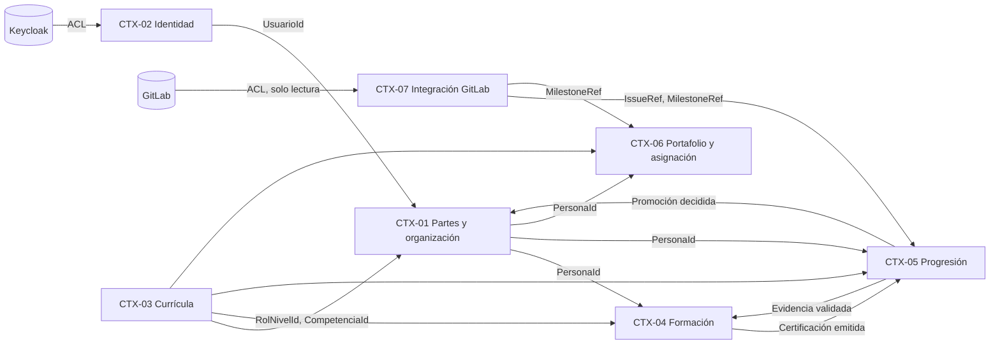

# DDM-001 — Modelo DDD del P3M

> **Alcance:** modelo de dominio (agregados, invariantes, contratos). **No** son tablas ni columnas: la persistencia es un puerto con adaptador MySQL (S3 y S5). Cada invariante cita su origen (BR, D-H, ADR o IM). Lo que no tiene origen se marca **PROPUESTA** y no es regla.

## 1. Mapa de contextos

| Relación | Patrón | Contrato (ADR-DB-002) |
|---|---|---|
| Keycloak → CTX-02 | Anti-corruption layer | GUID, username, correo y roles de usuario; el portal no los posee |
| GitLab → CTX-07 | Anti-corruption layer, solo lectura (BR-036) | Réplica de milestones e issues con delta |
| CTX-03 → CTX-01/04/05/06 | Upstream publicado (customer/supplier) | `RolNivelId`, `CompetenciaId`, `NivelDeLogro` por identificador |
| CTX-01 → CTX-04/05/06 | Upstream publicado | `PersonaId` (colaborador = persona con rol de colaborador) |
| CTX-02 → CTX-01 | Conformist con Keycloak | `UsuarioId` ligado a `PersonaId` |
| CTX-04 ⇄ CTX-05 | Evento asíncrono (RabbitMQ, ADR-P2) | `EvidenciaValidada` hacia CTX-04; `CertificacionEmitida` hacia CTX-05 |
| CTX-07 → CTX-05/06 | Upstream publicado | `IssueRef` (URL), `MilestoneRef` |
| CTX-05 → CTX-01 | Evento | `PromocionDeNivelDecidida` |

**Regla:** ningún contexto comparte tablas ni referencia claves foráneas de otro. Un identificador externo no es propiedad local.

## 2. Agregados por contexto

Autoridad y propiedad: la propiedad de cada contexto es la confirmada en DDP-001 (D-H6, D-H9).

### CTX-01 Partes y organización

| ID | Raíz | Contiene | Propiedad |
|---|---|---|---|
| AGG-01 | **Parte** (Persona u Organización) | Datos de contacto de la parte, persona u organización (OV: tipo correo/teléfono/dirección; D-160) | D-H6 |
| AGG-02 | **RolDeLaParte** (colaborador, evaluador) | Vigencia (OV: desde, hasta) | D-H6, D-H7 |
| AGG-03 | **RelaciónEntrePartes** (origen, destino, tipo: reporta a / membership / es parte de) | Vigencia | D-H6 |
| AGG-04 | **Plaza** | `OrganizaciónId`, **historial de rol/nivel** (entidad: `RolNivelId`, vigencia) | D-H9, D-H12 |
| AGG-05 | **OcupaciónDePlaza** | `PlazaId`, `PersonaId`, vigencia | D-H9 |

### CTX-02 Identidad de acceso

| ID | Raíz | Contiene | Propiedad |
|---|---|---|---|
| AGG-06 | **Usuario** (registro local) | GUID de Keycloak, username, correo, `PersonaId`. Los roles de usuario **no son propios**: se leen de Keycloak | ADR-11, D-H6 |

### CTX-03 Currícula

| ID | Raíz | Contiene | Propiedad |
|---|---|---|---|
| AGG-07 | **Seniority** | Niveles de desarrollo L1–L4 (entidades) | BR-011 |
| AGG-08 | **Competencia** | Definición de cada nivel de logro (OV), tipo único, indicador general/específica | BR-056, BR-060 |
| AGG-09 | **Rol** | Perfil de competencias (referencias a Competencia), **RolNivel** (entidad: nivel de desarrollo + nivel mínimo por competencia) | BR-012, BR-014 |

`NivelDeLogro` N1–N3 es un objeto de valor común (BR-013).

### CTX-04 Formación

| ID | Raíz | Contiene | Propiedad |
|---|---|---|---|
| AGG-10 | **Curso** | Objetivos (entidad: `CompetenciaId`, nivel objetivo), cada uno con su **Rúbrica** (OV por nivel de logro) y **EvidenciaEsperada** (obligatoria/deseable) | BR-017, BR-018, BR-058 |
| AGG-11 | **EdiciónDeCurso** | Número, fechas, cupo, `EvaluadorId`; **Enrolamiento** (entidad); **Certificación** (0..1 por enrolamiento) | BR-024, BR-026 |

### CTX-05 Progresión

| ID | Raíz | Contiene | Propiedad |
|---|---|---|---|
| AGG-12 | **EvidenciaAportada** | `IssueRef` (URL de GitLab), `EvidenciaEsperadaId`, estado, tipo curso/proyecto, quién valida | D-H3, D-H9 |
| AGG-13 | **ValoraciónDeCompetencia** (por colaborador y competencia) | Registros de nivel, solo se agregan | BR-004, BR-051 |
| AGG-14 | **EvaluaciónDeDesempeño** | Periodo, resultado, comentarios, evidencias y certificaciones consideradas | BR-083..089 |
| AGG-15 | **SolicitudDePromoción** | `RolNivelId` destino, evidencias que la sustentan | BR-064, BR-068 |
| AGG-16 | **PromociónDeNivel** | `RolNivelId` destino, certificaciones, evidencias de proyecto, valoraciones y `EvaluaciónDeDesempeñoId` | BR-007, BR-029, BR-030 |

### CTX-06 Portafolio y asignación

| ID | Raíz | Contiene | Propiedad |
|---|---|---|---|
| AGG-17 | **Producto** | Código, nombre, proyecto de GitLab | BR-032 |
| AGG-18 | **Proyecto** | `ProductoId`, `MilestoneRef`s, estimaciones, **RolNivelRequerido** (cantidad), **JefaturaDeProyecto** (`PersonaId`, vigencia) *(ver DEC-D01)* | BR-034, BR-048, D-H2, D-H8 |
| AGG-19 | **Asignación** | `PersonaId`, `ProyectoId`, `RolNivelId`, vigencia, % dedicación, estado, **ExcepciónDeAsignación** (0..1: `MotivoId`, aprobador) | BR-040..045, BR-078, BR-080, BR-093 |
| AGG-20 | **MotivoDeExcepción** (codificador) | Código y descripción | BR-043, BR-053 |

### CTX-07 Integración GitLab

| ID | Raíz | Contiene | Propiedad |
|---|---|---|---|
| AGG-21 | **CargaDeGitLab** | Fecha-hora, estado, reintentos, resultado («sin cambios desde la carga previa»), log | ADR-08, BR-090, BR-094 |
| RPL-01 | *Réplica de lectura* (Milestone, Issue, User Story, Tarea) | **No es agregado.** Copia de solo lectura; GitLab es la autoridad | ADR-08 §5 |

## 3. Invariantes

Cada una indica su **mecanismo**: dentro del agregado (A), política entre agregados con restricción única o bloqueo (P, ADR-P6) o evento entre contextos (E).

| ID | Invariante | Agregado | Origen | Mec. |
|---|---|---|---|---|
| INV-01 | Una parte es persona u organización. La exclusividad es INFERENCE | AGG-01 | R-76, R-77 | A |
| INV-02 | La persona tiene correo y teléfono obligatorios y puede tener varios | AGG-01 | BR-070 | A |
| INV-03 | Un colaborador tiene un solo «reporta a» vigente | AGG-03 | BR-071, ASR-10 | P |
| INV-04 | Un colaborador tiene una sola membresía vigente | AGG-03 | BR-076, ASR-10 | P |
| INV-05 | Una persona tiene una sola ocupación de plaza vigente (su rol/nivel vigente) | AGG-05 | BR-047 | P |
| INV-06 | Una plaza tiene como máximo una ocupación vigente | AGG-05 | D-H4 | P |
| INV-07 | Se conservan historiales con vigencia desde/hasta | AGG-02, 03, 04, 05, 18, 19 | BR-079, ASR-09 | A |
| INV-08 | Todo colaborador tiene usuario. Un usuario sin colaborador y sin rol JI/ADMIN/Instructor vuelve al login | AGG-06, AGG-02 | BR-077, D-H5 | E |
| INV-09 | Competencia: código, nombre, tipo único y definición de cada nivel. La general puede estar en varios perfiles, la específica solo en uno | AGG-08 | BR-056, BR-060 | A |
| INV-10 | Un seniority contiene los niveles L1 a L4 | AGG-07 | BR-011 | A |
| INV-11 | Un rol/nivel exige un nivel mínimo por cada competencia de su perfil | AGG-09 | BR-014, R-07 | A |
| INV-12 | Cada objetivo apunta a una competencia y a un nivel y define una rúbrica | AGG-10 | BR-017, BR-058 | A |
| INV-13 | Al llegar al cupo no se admiten más enrolamientos; el colaborador puede desenrolarse | AGG-11 | BR-026, BR-027 | A |
| INV-14 | La certificación se emite solo con el 100 % de las evidencias obligatorias validadas, la emite el Evaluador y no acredita sola el nivel de una competencia | AGG-11 | BR-021, BR-022, D-H3 | E |
| INV-15 | Una evidencia aportada está Pendiente o Validada y referencia un issue Closed de tipo Task o UserStory (URL de GitLab) | AGG-12 | BR-019, BR-020, D-H3 | A + E |
| INV-16 | Las valoraciones solo se agregan (historial). Las registra el Jefe de Ingeniería o ADMIN | AGG-13 | BR-004, BR-051 | A |
| INV-17 | Cada evaluación de desempeño registra fecha-hora y usuario y conserva historial | AGG-14 | BR-087, BR-089 | A |
| INV-18 | No hay promoción de nivel sin evaluación de desempeño. Solo la decide el Jefe de Ingeniería | AGG-16 | BR-007, BR-086, BR-088 | A |
| INV-19 | Un proyecto pertenece a un solo producto y cada milestone a un solo proyecto | AGG-18 | BR-048, BR-091, ASR-10 | A + P |
| INV-20 | Un proyecto tiene un solo jefe de proyecto vigente a la vez | AGG-18 | D-H2 | A |
| INV-21 | La suma de dedicación vigente de un colaborador no supera 100 % | AGG-19 | BR-093, ASR-10, ADR-P6 | P (bloqueo de filas) |
| INV-22 | Una asignación verifica el nivel mínimo. Si no lo cumple queda Pendiente hasta que haya excepción con motivo y aprobador | AGG-19 | BR-041..043 | A |
| INV-23 | Los roles/niveles requeridos los define un usuario con rol Jefe de Ingeniería o ADMIN | AGG-18 | D-H8 | A (permiso, ADR-P5) |
| INV-24 | La primera carga es completa, luego delta. 3 reintentos con esperas incrementales y circuit breaker. Los logs se retienen siempre | AGG-21 | ADR-08, BR-090, BR-094 | A |
| INV-25 | El portal no crea ni modifica issues, user stories ni milestones | RPL-01 | BR-036 | A |
| INV-27 | El rol/nivel de una plaza puede cambiar por promoción; tiene un solo rol/nivel vigente y se conserva el historial. El rol/nivel vigente de una persona es el de la plaza que ocupa | AGG-04 | D-H12, BR-047, BR-079 | A |
| INV-26 | Los datos personales se retienen igual que los logs | AGG-01 | D-H1 | A (política; ADR-P4 incompleto) |

## 4. Ciclo de vida y transiciones

Estados confirmados por ianache (D-H13).

| Agregado | Transiciones | Origen |
|---|---|---|
| EvidenciaAportada | Pendiente → Validada | BR-019 |
| Asignación | (solicitada) → Pendiente [si no cumple nivel mínimo] → (excepción aprobada) → vigente → finalizada. nombres confirmados por D-H13 | BR-042 |
| Enrolamiento | Inscrito → Certificado, o Desenrolado | BR-023, BR-027 |
| Rol de la parte, Ocupación, Relación, Jefatura | vigente → finalizada (hasta); nunca se borra | BR-079 |
| CargaDeGitLab | programada → ejecutando → completada/fallida/sin cambios; nombres confirmados por D-H13 | ADR-08, BR-090 |
| SolicitudDePromoción | registrada → evaluada → decidida (D-H13) | BR-064, BR-068 |

## 5. Comandos y eventos de dominio

| Contexto | Comandos | Eventos |
|---|---|---|
| CTX-01 | RegistrarPersona, AgregarDatoDeContacto, IniciarRol, FinalizarRol, RegistrarRelación, AbrirPlaza, CambiarNivelDePlaza, OcuparPlaza, LiberarPlaza | PersonaRegistrada, RolIniciado, OcupaciónIniciada, OcupaciónFinalizada, NivelDePlazaCambiado |
| CTX-02 | RegistrarUsuarioAlIniciarSesión | UsuarioRegistrado |
| CTX-03 | DefinirCompetencia, DefinirRol, DefinirNivelMínimo | CurrículaActualizada |
| CTX-04 | DefinirCurso, CrearEdición, Enrolar, Desenrolar, EmitirCertificación | EnrolamientoRegistrado, CertificaciónEmitida |
| CTX-05 | RegistrarEvidencia, ValidarEvidencia, RegistrarValoración, RegistrarEvaluación, SolicitarPromoción, DecidirPromoción | EvidenciaValidada, PromociónDeNivelDecidida |
| CTX-06 | RegistrarProducto, RegistrarProyecto, DefinirRolNivelRequerido, DesignarJefeDeProyecto, Asignar, AprobarExcepción | AsignaciónRegistrada, AsignaciónPendiente, ExcepciónAprobada |
| CTX-07 | EjecutarCarga, ReintentarCarga | CargaCompletada, IssuesActualizados, GitLabNoDisponible |

## 6. Puertos y adaptadores (hexagonal, ADR-DB-002)

| Puerto | Tipo | Adaptador |
|---|---|---|
| `<Agregado>Repository` (uno por raíz) | Salida, persistencia | MySQL 8.x + Flyway (ADR-DB-003) |
| `IdentityPort` | Salida | Keycloak (ADR-11) |
| `GitLabReadPort` | Salida, solo lectura | API de GitLab con reintentos y circuit breaker (ADR-08, ADR-09) |
| `EventPublisherPort` / `EventConsumerPort` | Salida/Entrada | RabbitMQ (ADR-P2) |
| `LockPort` (por colaborador) | Salida | Transacción con `SELECT … FOR UPDATE` (ADR-P6) |
| Comandos HTTP | Entrada | ~~FastAPI~~ detrás del BFF (ADR-13). **Nota 2026-10-13:** ADR-16 reemplaza FastAPI por Spring Boot; los puertos se organizan según ADR-17 (interfaces de repositorio en `domain`, adaptadores en `infrastructure`). Este documento no se modificó más; queda pendiente al verificarlo de nuevo |

## 7. Evaluación del UDM (solo consejo)

| Correspondencia UDM | Disposición | Motivo |
|---|---|---|
| Party, Person, Organization | **Aceptada** | ADR-10, D-129 |
| Contact Mechanism | **Aceptada** | BR-070 (FACT) |
| Party Relationship | **Aceptada** | BR-071, BR-072, BR-076 |
| Position Type, Position, Position Fulfillment | **Aceptada** | D-130, D-131 |
| Party Role (colaborador, evaluador) | **Aceptada** | D-H7 |
| Party Role (jefe de proyecto) | **Solo evidencia** | D-H10: la jefatura vive en Proyecto |
| Position (nivel cambiante) | **Solo evidencia** | D-H12: la plaza cambia de rol/nivel; el UDM trata el tipo de puesto como estable |
| User Login | **Solo evidencia** | INFERENCE; Keycloak es la autoridad (ADR-11) |
| Work Effort Party Assignment | **Solo evidencia** | INFERENCE (IMD-001 §5.1) |

El UDM no cubre decisiones de SSOT ni de ADR faltantes.

## 8. Decisiones resueltas

Responsable funcional: ianache, 2026-10-11, en sesión.

| ID | Decisión | Resuelve | Efecto en el modelo |
|---|---|---|---|
| D-H10 | La jefatura de proyecto vive dentro de **Proyecto** (CTX-06), con vigencia. CTX-01 solo guarda los roles de colaborador y evaluador | DEC-D01 | AGG-18 contiene JefaturaDeProyecto; INV-20 es interna del agregado |
| D-H11 | Una sola evidencia aportada por evidencia esperada y enrolamiento, reemplazable mientras esté Pendiente. Sin estado Rechazada | DEC-D02 | AGG-12 con una sola evidencia por esperada; estados Pendiente → Validada |
| D-H12 | Al promover, **la plaza cambia de rol/nivel**. La persona sigue en la misma plaza | DEC-D03 | AGG-04 guarda el historial de rol/nivel de la plaza (INV-27). Evento `PromociónDeNivelDecidida` → comando `CambiarNivelDePlaza`. La ocupación no se cierra |
| D-H13 | Se confirman los estados de §4 (Asignación, Solicitud de promoción, Carga) | DEC-D04 | Estados fijados |

**Consecuencia de D-H12 que debes conocer.** BR-079 decía que el historial de nivel y seniority se conserva en las ocupaciones de plaza con vigencia. Si la plaza cambia de nivel y la ocupación continúa, ese historial ya no está en la ocupación. Por eso la plaza guarda su propio historial de rol/nivel con vigencia (INV-27). Es una derivación necesaria para cumplir BR-079, no una regla nueva. Hay que reflejarla en IMD-001 (R-85) y BRC-001.

**Arrastradas, no bloquean:** C-05 (permiso del jefe de proyecto para registrar roles/niveles) y A-04 (varios roles de la parte a la vez).

**Trabajo para S4 (no es decisión humana):** la certificación (INV-14) y la evidencia (INV-15) cruzan CTX-04, CTX-05 y CTX-07. Su mecanismo de consistencia se define en `INTEGRATION_CONTRACT_READY`.

## 9. Estado del gate

`DDD_MODEL_READY` = **PASSED**, por decisión de ianache (2026-10-11).

| Requisito | Estado |
|---|---|
| Gate predecesor | Cumplido (DDP-001 PASSED) |
| Propiedad por agregado | Cumplido (§2) |
| Invariantes | Cumplido con origen (§3) |
| Ciclo de vida | Cumplido (§4, D-H13) |
| Fronteras de contexto | Cumplido (§1, D-H10) |
| Decisiones sin resolver | Ninguna bloqueante (§8) |

**Deuda para S3:** actualizar IMD-001 y BRC-001 con D-H1..D-H13 (ADR-DB-001); U-01 (ADR-P4: clasificación, cifrado, acceso), IM-Q6, IM-Q9, IM-Q26, IM-Q28, IM-Q29; confirmar C-05 y A-04.
