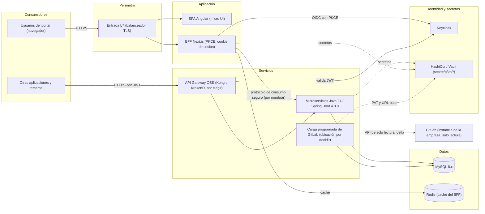
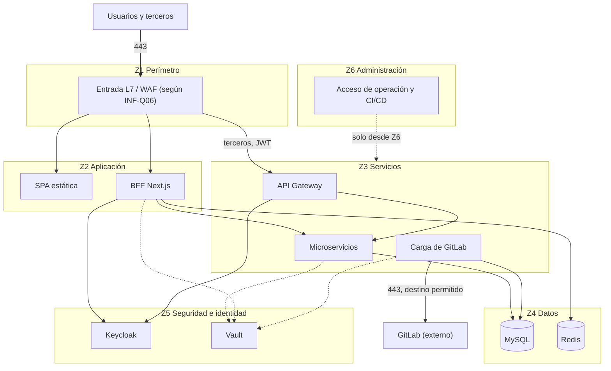
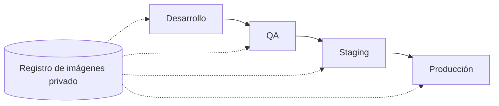

# INF-P3M-001: Arquitectura de infraestructura del P3M (P3M)

## 1. Resumen

Este documento diseña la infraestructura del P3M (P3M) del Área de Desarrollo de COMSATEL. Parte de 20 requisitos arquitectónicamente significativos (ASR) y 15 decisiones de arquitectura (ADR) ya declaradas. El diseño es lógico e independiente del proveedor: describe capacidades, zonas de red, secretos, datos, resiliencia y ambientes.

**Resultado clave:** el diseño lógico está completo, pero **no se puede dar por listo para desarrollo** porque faltan insumos críticos: el modelo de despliegue (nube, on-premise o híbrido), la plataforma que ejecuta los contenedores (ADR-P7) y la carga esperada completa (INF-Q03 es parcial). Los objetivos de disponibilidad, RTO y RPO se definieron el 2026-10-10 (INF-Q02) y se reparten en dos clases de falla (INF-DEC-23). No inventé ninguna cifra: lo que falta aparece como `UNKNOWN` o `SUPUESTO`.

**Estado:** `REQUIRES_REVIEW`. **Siguiente acción:** que Arquitectura responda las preguntas bloqueantes de la sección 15 (INF-Q01 a INF-Q05) y tome las decisiones INF-DEC marcadas como pendientes.

## 2. Alcance, supuestos y no-objetivos

- **Alcance:** topología de despliegue, zonas de red y flujos, cómputo, datos, secretos, identidad, observabilidad, resiliencia y recuperación, ambientes, capacidad y operación del portal y sus dependencias (Keycloak, Vault, MySQL, Redis, API Gateway, microservicios, BFF, SPA y la conexión con GitLab).
- **No-objetivos:** arquitectura de las aplicaciones y límites de los microservicios (ADR-P2), modelo de datos (lo traduce el skill de modelo de datos), código de infraestructura productivo, y la infraestructura interna de GitLab.

**Supuestos** (ninguno proviene de una fuente del proyecto; deben confirmarse):

| ID | Supuesto | Marca | Efecto si es falso |
|---|---|---|---|
| SUP-01 | El portal es de uso interno del Área de Desarrollo y de COMSATEL. La carga es la de una aplicación interna, no la de un servicio masivo | SUPUESTO | El dimensionamiento y la exposición a internet cambian |
| SUP-02 | Cada servicio sin estado se ejecuta con al menos 2 réplicas en dominios de falla distintos | SUPUESTO (principio de diseño de alta disponibilidad) | Aparece un punto único de falla |
| SUP-03 | Existen los ambientes desarrollo, QA, staging y producción | SUPUESTO | El esquema de la sección 10 cambia |
| SUP-04 | Hay un único proceso de carga de GitLab (no uno por producto) | SUPUESTO | Cambia el volumen de logs y las conexiones a GitLab |
| SUP-05 | Redis guarda solo datos regenerables, no el sistema de registro | SUPUESTO (a confirmar en ADR-P1) | Si guarda la sesión del BFF, Redis pasa a ser crítico |

## 3. Insumos y trazabilidad

| ID | Fuente | Versión | Confianza | Qué condiciona |
|---|---|---|---|---|
| ASR-01 a ASR-20 | [asr-catalog](../architecture/asr/asr-catalog.md) y [asr/](../architecture/asr/) | `draft` | Decisión humana, sin revisión de un arquitecto | Requisitos de seguridad, resiliencia, retención, contenerización |
| ADR-01 a ADR-15 | [CAT-ADR-001](../architecture/CAT-ADR-001-decisiones-de-arquitectura.md) y [adr/](../architecture/adr/) | `draft` | Aceptadas por el responsable, sin revisión de un arquitecto | Tecnologías y patrones fijados |
| ADR-P1 a ADR-P11 | [adr/](../architecture/adr/) | `draft` | Pendientes | Decisiones que siguen abiertas |
| EVA-001 | [EVA-001](../architecture/EVA-001-evaluacion-api-gateway.md) | `draft` | Recomendación, no decisión | API Gateway |
| Pack y reglas | [RCP-001](../requirements/context-packs/RCP-001-portal-gestion-curricula-desarrollo.md), [BRC-001](../business/rules/BRC-001-reglas-de-negocio-portal-curricula.md) | Aprobado por ianache | Alta | GitLab es una instancia privada de la empresa (riesgo R-08 del pack) |

## 4. Requisitos que condicionan la infraestructura

| ID | Requisito | Objetivo | Fuente |
|---|---|---|---|
| ASR-01, ASR-02 | Seguridad de ingreso y sesión alineada con Keycloak | Sin datos sensibles en el navegador. Tiempo de sesión: `UNKNOWN` (RQ-31) | ADR-01 a ADR-03 |
| NFR disponibilidad | Disponibilidad | **`UNKNOWN`** | Ninguna fuente |
| NFR disponibilidad, RTO y RPO | Recuperación | 99,9 % (unos 43,8 min al mes), RTO 4 h y RPO 1 h con respaldos de MySQL cada hora | INF-Q02 (2026-10-10). Se reparten en dos clases de falla (INF-DEC-23) |
| NFR rendimiento y capacidad | Usuarios concurrentes, tamaño de datos | **`UNKNOWN`**. Derivado: la carga de GitLab corre cada 30 s | ASR-05 (BR-039) |
| ASR-05, ASR-06, ASR-07 | Carga de GitLab con delta, reintentos y circuit breaker | 30 s por defecto, 3 reintentos, apertura tras 5 fallos y 5 min abierto (propuesta del anexo B del pack, sin confirmar) | ADR-08, ADR-09 |
| ASR-08 | Retención | Logs de carga por siempre | ADR-08 |
| ASR-14 | Datos personales | Política pendiente (G-12) | ADR-P4 |
| ASR-17 a ASR-19 | Secretos, consumo seguro y API Gateway | `secret/p3m/*` en Vault, protocolo seguro sin JWT entre BFF y microservicios, JWT para terceros | ADR-12 a ADR-14 |
| ASR-20 | Contenerización completa | Todos los componentes en contenedores | ADR-15 |

## 5. Modelo de despliegue

**Decisión (2026-10-10, responsable):** desarrollo en contenedores Docker en la máquina del desarrollador; QA, PRE y PROD en la nube, en Oracle OKE (Kubernetes). ADR-P7 indica además OKE para DEV: por confirmar. INF-Q01 queda respondida.

Evidencia disponible: GitLab es una instancia privada de la empresa (riesgo R-08 del pack), y el portal necesita llegar a ella cada 30 segundos. La política de datos personales está pendiente (G-12). No hay datos de presupuesto, personal de operación ni residencia.

| Criterio | A. Nube pública | B. On-premise | C. Híbrido (por ejemplo, núcleo on-premise y recuperación en nube) |
|---|---|---|---|
| Conectividad a GitLab privado | Exige VPN o enlace dedicado a la red de la empresa | Directa por la red interna | Directa desde el núcleo on-premise |
| Residencia y datos personales | A confirmar con G-12 | Control físico total | Los datos personales quedan en el núcleo |
| Elasticidad | Alta, pero la carga esperada de un portal interno es baja (SUP-01) | Limitada por la capacidad instalada | Elástica solo en la parte de nube |
| Time-to-market | Rápido | Depende del hardware y la plataforma ya instalada | Intermedio |
| Capacidades del equipo | `UNKNOWN` | `UNKNOWN` | `UNKNOWN`, exige operar ambos lados |
| Costo | `UNKNOWN`. Sin precios consultados | `UNKNOWN` | `UNKNOWN` |
| Portabilidad | Buena: todas las tecnologías fijadas son portables (MySQL, Redis, Vault, Keycloak, contenedores) | Buena | Buena, pero con más piezas de conectividad e identidad federada |
| Recuperación ante desastres | Regiones de nube | Requiere un segundo sitio | Nube como sitio de recuperación |

**Recomendación:** ninguna por ahora. Con los datos disponibles no hay un criterio que decida: depende de si COMSATEL ya tiene una plataforma de contenedores interna (INF-Q04) y de la política de datos personales (G-12). Si ya existen GitLab y Keycloak internos, B o C reducen la conectividad que hay que construir. La decisión es humana y debe registrarse como un ADR nuevo.

## 6. Arquitectura lógica (independiente del proveedor)

| Componente | Tipo de carga | Dependencias | Clase de datos | Criticidad |
|---|---|---|---|---|
| SPA Angular | Estática (cómo se sirve: `UNKNOWN`, INF-Q10) | BFF | Pública | Media |
| BFF Next.js | Sin estado de dominio. Guarda la sesión del navegador (cookie) | Keycloak, Redis, microservicios, Vault | Sesión, tokens | Alta: sin BFF nadie ingresa |
| Keycloak | Con estado (su base de datos: `UNKNOWN`, INF-Q07) | Su almacén | Identidades, credenciales | Alta |
| API Gateway | Sin estado (KrakenD) o con configuración declarativa | Keycloak (JWKS), microservicios | Tráfico externo | Media |
| Microservicios Java / Spring Boot (ADR-16) | Sin estado de dominio. Cuántos hay: `UNKNOWN` (ADR-P2) | MySQL, Vault | Datos de negocio y personales | Alta |
| Carga programada de GitLab | Por lotes, una a la vez | GitLab, MySQL, Vault | Copia local de issues y milestones | Media |
| MySQL 8.x | Con estado | Almacenamiento persistente | Datos de negocio, historiales y logs, datos personales | Crítica |
| Redis | Caché | Memoria | Regenerables (SUP-05) | Media |
| Vault | Con estado | Su almacenamiento | Secretos | Crítica |
| GitLab | Externo | n/a | n/a | Media (el portal degrada con aviso, ASR-07) |

## 7. Diseño por dominio

Cada decisión `INF-DEC-nn` enlaza a su ASR o ADR. Las decisiones marcadas **PENDIENTE** no pueden cerrarse con las fuentes actuales.

### 7.1 Cómputo y orquestación

- **INF-DEC-01.** Todos los componentes se ejecutan como contenedores (ADR-15, ASR-20). Los componentes con estado (MySQL, Vault, Keycloak) pueden ejecutarse como contenedores o como servicios gestionados, según el modelo de despliegue.
- **INF-DEC-02 (PENDIENTE).** Plataforma de ejecución de contenedores: ADR-P7. El diseño asume las capacidades de un orquestador (réplicas, probes de salud, despliegue gradual con reversión, límites de recursos, integración con secretos). Un orquestador concreto (por ejemplo Kubernetes) es la opción habitual para esas capacidades, pero no está decidido.
- **INF-DEC-03.** Los componentes sin estado (SPA, BFF, gateway, microservicios) corren con al menos 2 réplicas en dominios de falla distintos (SUP-02), con probes de salud y despliegue gradual con reversión.
- **INF-DEC-04.** La carga programada de GitLab corre como un único proceso a la vez, sin solapar ejecuciones (anexo B del pack, ADR-P3). Dónde corre (microservicio propio o tarea programada) está pendiente.
- **Autoescalado:** requiere la carga base (`UNKNOWN`). Hasta entonces, réplicas fijas.
- **Imágenes:** base mínima, sin secretos, versionadas, con escaneo de vulnerabilidades antes de promover (INF-DEC-14).

### 7.2 Red y zonas de seguridad

- **INF-DEC-05.** Cinco zonas: perímetro, aplicación, servicios, datos, y seguridad e identidad, más una zona de administración (ASR-01, ASR-10, ASR-14). Los almacenes de datos y Vault no son accesibles desde fuera de la red interna.
- **INF-DEC-06.** Un único punto de entrada de usuarios, que llega al BFF y a los estáticos de la SPA. Los consumidores externos entran solo por el API Gateway (ADR-14, ASR-19). Los microservicios no tienen entrada directa.
- **INF-DEC-07.** El tráfico entre el BFF y los microservicios está cifrado y autenticado con un protocolo de consumo seguro (ADR-13, ASR-18). Su nombre está pendiente (ADR-P9).
- **INF-DEC-08.** Salida a internet o a otras redes solo hacia GitLab, con lista de destinos permitidos. El resto de la salida se deniega (ASR-04).
- **Terminación TLS y certificados:** TLS en el perímetro y en los saltos internos. Quién emite los certificados (internos o públicos) y cómo se rotan: `UNKNOWN` (INF-Q12).
- **Direccionamiento y DNS:** los rangos no deben solaparse con las redes de la empresa. Valores: `UNKNOWN`.
- **Acceso de usuarios:** si el portal es accesible solo desde la red corporativa o también desde internet: `UNKNOWN` (INF-Q06). Condiciona la entrada y el firewall de aplicaciones web (WAF).

### 7.3 Almacenamiento

- **INF-DEC-09.** MySQL 8.x usa almacenamiento en bloque persistente y cifrado en reposo (ADR-05, ASR-14). Rendimiento (IOPS): `UNKNOWN`.
- **INF-DEC-10.** Backups de MySQL: completos más registros binarios para recuperación a un instante. Respaldos cada hora (INF-Q02), que cumplen el RPO de 1 h del desastre (INF-DEC-23); la retención sigue sin definir. Una copia sale del dominio de falla del primario y se cifra. **La restauración se prueba de forma periódica** (sección 14).
- **Retención de logs de carga por siempre (ASR-08):** crecimiento sin límite. Derivado de D-69 y BR-094: con una carga cada 30 s hay 2.880 ejecuciones por día y unas 1.051.200 por año por cada proceso de carga (SUP-04). El tamaño por registro es `UNKNOWN`. Hace falta una política de archivado o de partición que cumpla «por siempre» sin degradar la base operativa (INF-Q13).
- **Objetos y archivos:** no aplica por ahora: ninguna fuente exige almacenamiento de objetos o de archivos. Los estáticos de la SPA no necesitan almacenamiento persistente propio.

### 7.4 Datos y mensajería

- **INF-DEC-11.** MySQL 8.x con alta disponibilidad: un nodo primario y al menos una réplica en otro dominio de falla, con conmutación (ADR-05, ASR-09, ASR-10). Por INF-DEC-23 la réplica debe conmutar en minutos con replicación **semisíncrona o de grupo**: con una asíncrona, una conmutación podría perder más de 1 h de datos. El modo concreto se decide en ADR-P6 junto con las restricciones «una sola vigente» y «suma ≤ 100 %».
- **INF-DEC-23 (dos clases de falla; decisión de ianache, 2026-10-12, opción A).** El objetivo de disponibilidad del 99,9 % (unos 43,8 min al mes) rige las **fallas normales** (caída de un nodo, de una réplica o de un servicio): se atienden con réplicas y conmutación automática en minutos, sin pérdida de datos confirmados. El **RTO de 4 h y el RPO de 1 h** rigen el **desastre** (pérdida del sitio o corrupción de datos): restauración desde los respaldos horarios. Consecuencias: (1) MySQL necesita una réplica con conmutación automática y replicación semisíncrona o de grupo; (2) un desastre que consuma las 4 h agota el presupuesto de ese mes, y se acepta como evento excepcional; (3) se verifica con una conmutación y una restauración de prueba (sección 14), todavía sin ejecutar.
- **INF-DEC-12.** Redis es una caché del BFF, sin persistencia obligatoria y con política de expulsión (ADR-06, SUP-05). Su caída solo degrada el rendimiento, salvo que guarde la sesión (ADR-P1). Alta disponibilidad de Redis: solo si ADR-P1 lo exige.
- **Propiedad de datos:** el esquema de cada microservicio no lo accede otro directamente. La división está pendiente (ADR-P2).
- **Mensajería:** no aplica — ninguna fuente exige un broker. La carga de GitLab es una tarea programada, no un flujo de eventos.
- **Multitenencia:** no aplica — el portal es de una sola organización. Proveedores y organizaciones son datos de negocio (ADR-10), no inquilinos de infraestructura.

### 7.5 Identidad, secretos y cifrado

- **INF-DEC-13.** Keycloak es el proveedor de identidad para usuarios y para clientes externos (ADR-11, ADR-02, ADR-14). Su alta disponibilidad y su base de datos son un requisito para que el portal sea disponible (INF-Q07).
- **INF-DEC-22 (requisito de identidad).** No hay registro libre ni auto-registro de cuentas: ni el login del portal ni el flujo de login de Keycloak lo habilitan. Las identidades llegan a Keycloak por su conexión con **Active Directory**, que gestiona el equipo de infraestructura, y el **correo es de solo lectura** (RCP-001 D-157, BRC-001 BR-128). Es un requisito de despliegue: si se habilitara el registro libre o la edición del correo, el vínculo del usuario con su persona por el correo (BR-125) permitiría suplantar a un colaborador (RPT-DDR-001 R-01). La configuración se mantiene como código y se verifica (sección 14). Cómo se federa con Active Directory y qué pasa si no responde: `UNKNOWN` (INF-Q17).
- **INF-DEC-14.** Los secretos viven en Vault bajo `secret/p3m/*`: credenciales de MySQL, usuario y contraseña de Redis, PAT de GitLab y URL base de GitLab (ADR-12, ASR-17). Las cargas los obtienen en tiempo de ejecución. **Nunca van en imágenes, en variables fijas de la imagen ni en el navegador** (ADR-15). Cómo se autentica cada carga en Vault y cómo se rotan: ADR-P11.
- **PAT de GitLab:** un PAT está ligado a un usuario. Si esa cuenta se desactiva, la carga deja de funcionar. Debe confirmarse que sea de solo lectura y a nombre de una cuenta de servicio (ADR-P11, R-07).
- **Cifrado:** TLS en tránsito entre todos los saltos (INF-DEC-07) y cifrado en reposo en MySQL, Vault y los backups (ASR-14). La gestión de claves de cifrado y su custodia: `UNKNOWN`.

### 7.6 Seguridad

- **INF-DEC-15.** Mínimo privilegio: cada microservicio accede solo a su esquema, y solo los microservicios acceden a MySQL (no el BFF). Separación de funciones entre administración, operación y desarrollo.
- **INF-DEC-16.** La cadena de entrega incluye escaneo de vulnerabilidades de imágenes y dependencias, firma de imágenes y bloqueo de promociones con hallazgos críticos. La herramienta está pendiente (INF-Q11).
- **Auditoría y detección:** los accesos administrativos, los eventos de Keycloak y los de Vault se registran y alertan. Dónde se centralizan: `UNKNOWN`.
- **Modelo de amenazas resumido:**

| Activo | Superficie | Control |
|---|---|---|
| Sesión del usuario | Navegador y cookie del BFF | PKCE, sin tokens en el navegador, cookie alineada con Keycloak (ASR-01, ASR-02) |
| Datos personales | MySQL y logs | Segmentación, cifrado en reposo, acceso mínimo, política pendiente (ADR-P4) |
| Secretos | Vault | Autenticación de cargas, rotación, sin secretos en imágenes (ADR-12) |
| API expuestas | API Gateway | JWT de Keycloak, límites de uso por cliente (ADR-14, ADR-P10) |
| Cuenta de GitLab | PAT | Alcance de solo lectura, cuenta de servicio, lista de destinos permitidos |

- **Cumplimiento:** aplicable `UNKNOWN`. La política de datos personales (G-12) define la evidencia que la infraestructura debe producir.

### 7.7 Observabilidad

- **INF-DEC-17.** Métricas, logs y trazas de todos los componentes, con correlación por identificador de solicitud. Herramientas y retención: `UNKNOWN` (INF-Q09). Los logs de carga de GitLab son datos de negocio y se retienen por siempre (ADR-08); el resto de los logs técnicos tienen su propia retención por definir.
- **SLIs derivados de los ASR** (los objetivos SLO son `UNKNOWN` y deben definirse):

| SLI | Fuente | Alerta sugerida | Responsable |
|---|---|---|---|
| Tasa de éxito de las cargas de GitLab | ASR-05, ASR-06 | Cargas fallidas consecutivas | Por definir |
| Antigüedad de la última carga exitosa | ASR-07 | Superar el umbral que defina Arquitectura | Por definir |
| Estado del circuit breaker (cerrado, abierto, semiabierto) | ASR-06 | Abierto | Por definir |
| Tasa de éxito de ingreso y de cierre de sesión | ASR-01, ASR-02 | Caída sostenida | Por definir |
| Latencia y errores de las API (Portal y gateway) | ASR-19 | Valores por definir | Por definir |
| Salud de MySQL: réplica atrasada, espacio, backups | ASR-09, ASR-10 | Atraso, disco, backup fallido | Por definir |
| Estado de Vault (sellado, disponible) | ASR-17 | Sellado | Por definir |
| Vencimiento de certificados | INF-DEC-05 | Quedan pocos días | Por definir |

### 7.8 Resiliencia y recuperación (DR)

Ver la sección 12. Principios:

- **INF-DEC-18.** Degradación controlada: si GitLab no responde, el portal sigue operando con la última copia y muestra «datos al <fecha y hora de la última carga exitosa>» (ASR-07). El circuit breaker evita saturar a GitLab (ASR-06).
- **INF-DEC-19.** Si Redis falla, el BFF sigue operando sin caché (SUP-05).
- **INF-DEC-20.** Si Keycloak o Vault caen, no hay ingreso nuevo ni se pueden arrancar cargas nuevas que necesiten secretos. Por eso ambos deben ser de alta disponibilidad (sección 13, R-03 y R-04).

### 7.9 Ambientes y CI/CD

Ver la sección 10. Aprovisionamiento por código de infraestructura con detección de desvíos, registro de imágenes privado y promoción entre ambientes con aprobación. La herramienta de integración y entrega continua y el registro de imágenes están pendientes (INF-Q11); GitLab, que ya usa la empresa, es una opción a evaluar, no una decisión.

### 7.10 Capacidad y costos

Ver la sección 11.

### 7.11 Operación y gobierno

- **INF-DEC-21 (PENDIENTE).** Quién opera cada capa (equipo de plataforma, de aplicación, de seguridad), guardias, ventanas de mantenimiento y runbooks: `UNKNOWN` (INF-Q14). Runbooks mínimos que deben existir antes de producción: restauración de MySQL, conmutación de MySQL, desellado de Vault, reapertura del circuit breaker, rotación del PAT de GitLab y rotación de certificados.
- **Inventario y costeo:** todo recurso se etiqueta con el producto (P3M), el ambiente y el responsable.

## 8. Mapeo a servicios concretos

No consulté precios, versiones ni límites de ningún proveedor. Los servicios son ejemplos que deben verificarse con su documentación vigente antes de citarlos; fecha de consulta: **no consultado**.

| Capacidad | Nube (a verificar) | On-premise | Notas y limitaciones |
|---|---|---|---|
| Plataforma de contenedores | Servicio gestionado de orquestación de la nube elegida | Orquestador propio de la empresa | ADR-P7. Define la sección 7.1 |
| Entrada L7 y TLS | Balanceador L7 gestionado | Balanceador propio o ingress | Con WAF si el acceso es desde internet (INF-Q06) |
| API Gateway | KrakenD CE o Kong OSS en contenedores | Igual | Evaluación en [EVA-001](../architecture/EVA-001-evaluacion-api-gateway.md) |
| Identidad | Keycloak en contenedores o instalación gestionada | Keycloak propio | Su base de datos debe ser de alta disponibilidad (INF-Q07) |
| Secretos | HashiCorp Vault (propio o servicio de HashiCorp) | Vault propio | ADR-12. Almacenamiento y alta disponibilidad: INF-Q08 |
| Base de datos relacional | MySQL 8.x gestionado, si el servicio ofrece esa versión | MySQL 8.x con replicación propia | ADR-05. Verificar compatibilidad de versión |
| Caché | Redis gestionado o en contenedores | Redis propio | ADR-06 |
| Almacenamiento en bloque | Discos gestionados cifrados | SAN o almacenamiento distribuido | Rendimiento `UNKNOWN` |
| Registro de imágenes | Registro privado del proveedor | Registro privado propio | Puede ser el de GitLab (por evaluar) |
| Observabilidad | Pila de métricas, logs y trazas, gestionada o propia | Pila propia | INF-Q09 |
| Copia de seguridad fuera del dominio de falla | Almacenamiento de objetos de otra región | Almacenamiento en otro sitio | Cifrada, con prueba de restauración |

## 9. Red y zonas de seguridad

**Flujos permitidos** (todo lo no listado se deniega por defecto; los puertos son los habituales del producto y deben confirmarse):

| Origen | Destino | Puerto / protocolo | Propósito | Control |
|---|---|---|---|---|
| Usuarios | Entrada L7 | 443 / HTTPS | Acceso al portal | TLS, WAF si hay acceso desde internet |
| Terceros | API Gateway (vía entrada L7) | 443 / HTTPS con JWT | Consumir las API | Validación del JWT, límite de uso por cliente |
| Entrada L7 | SPA y BFF | 443 / HTTPS | Servir la SPA y las solicitudes | Red interna |
| BFF | Keycloak | 443 / HTTPS (OIDC con PKCE) | Autenticar y cerrar sesión | Cliente del BFF en Keycloak |
| BFF | Microservicios | Protocolo de consumo seguro (ADR-P9) | Consumir las API internas | Autenticación y cifrado entre servicios |
| BFF | Redis | 6379 / TCP con autenticación | Caché | Política de red: solo el BFF |
| API Gateway | Keycloak | 443 / HTTPS | Obtener las claves para validar el JWT | Solo el gateway |
| Keycloak | Active Directory | LDAP o LDAPS (por definir, INF-Q17) | Federación de identidades: altas, bajas y correo de los usuarios | Cuenta de servicio de Keycloak de solo lectura; gestionado por infraestructura |
| API Gateway | Microservicios | A definir según ADR-P9 | Reenviar llamadas validadas | Solo el gateway |
| Microservicios | MySQL | 3306 / TCP con TLS | Persistencia | Política de red: solo microservicios, cada uno a su esquema |
| Carga de GitLab | MySQL | 3306 / TCP con TLS | Guardar la copia local y los logs | Solo la carga |
| Carga de GitLab | GitLab | 443 / HTTPS | Leer issues y milestones | Salida con destino permitido, PAT de solo lectura |
| BFF, microservicios y carga | Vault | 8200 / HTTPS | Obtener secretos | Autenticación por carga (ADR-P11) |
| Operación y CI/CD | Zonas internas | Según la herramienta | Despliegue y operación | Solo desde la zona de administración, con auditoría |
| Internet | Z4 y Z5 | Ninguno | Los almacenes y Vault no se exponen | Denegado |

## 10. Ambientes

El conjunto de ambientes es un supuesto (SUP-03).

| Ambiente | Propósito | Diferencias respecto a producción | Datos |
|---|---|---|---|
| Desarrollo | Trabajo diario del equipo | Una réplica, sin alta disponibilidad, recursos mínimos | Sintéticos |
| QA | Pruebas funcionales | Igual topología lógica, sin alta disponibilidad | Sintéticos o enmascarados |
| Staging | Prueba de despliegue y de rendimiento | Misma topología que producción, escala reducida o igual según la prueba | Enmascarados, nunca datos productivos sin enmascarar |
| Producción | Uso real | Alta disponibilidad, backups, auditoría y alertas completas | Reales |

- Cada ambiente tiene su propio Vault o su propia ruta aislada de secretos (el diseño actual fija `secret/p3m/*` sin distinguir ambiente: **INF-Q08**). Ningún ambiente comparte secretos con otro.
- Cada ambiente apunta a su propia instancia de GitLab de prueba o a un proyecto de solo lectura con datos controlados (INF-Q15).
- Los datos personales de producción no se copian a otros ambientes sin enmascarar (ASR-14).

## 11. Capacidad, dimensionamiento y costo

**No se puede dimensionar:** la carga base es `UNKNOWN`. La fórmula y las variables que Arquitectura debe aportar son:

| Recurso | Fórmula | Variables que faltan |
|---|---|---|
| Réplicas de BFF y microservicios | `ceil(pico de solicitudes por segundo × latencia media en segundos ÷ concurrencia por réplica) × (1 + margen)`, con mínimo de 2 réplicas (SUP-02) | Pico de solicitudes, latencia objetivo, concurrencia, margen |
| Espacio de MySQL | `(registros por año × tamaño medio × (1 + índices)) × años × factor de crecimiento` | Número de colaboradores, evidencias, evaluaciones, tamaño medio |
| Logs de carga | `ejecuciones por día × 365 × tamaño por registro`, con 2.880 ejecuciones por día por proceso (30 s) | Tamaño por registro, número de procesos (SUP-04) |
| Memoria de Redis | `datos en caché × factor de sobrecarga` | Qué se cachea y su tiempo de vida (ADR-P1) |
| Ancho de banda hacia GitLab | `tamaño del delta × cargas por día` | Tamaño típico del delta de issues y milestones |

**Costo:** no se estima. No hay precios consultados ni modelo de despliegue. Los factores de costo son: cómputo de los contenedores, base de datos y su réplica, copias de seguridad y su retención (los logs por siempre crecen sin límite), tráfico saliente, licencias y soporte (por ejemplo, la edición comercial de Vault o de un API Gateway), observabilidad y personal de operación. Horizonte y supuestos los define Arquitectura una vez decidido el modelo de despliegue.

Palancas de optimización: apagar o reducir los ambientes que no son de producción fuera de horario, particionar y archivar los logs antiguos, y ajustar la retención de los logs técnicos.

## 12. Resiliencia y DR

Objetivos (INF-Q02, INF-DEC-23): en fallas normales, 99,9 % con recuperación automática en minutos; en desastre, RTO 4 h y RPO 1 h. Los componentes distintos de MySQL no tienen objetivo propio (`UNKNOWN`). La columna «diseñado» muestra lo que la estrategia propuesta puede lograr, no un compromiso.

| Componente | Dominio de falla | RTO/RPO objetivo | RTO/RPO diseñado | Estrategia | Prueba |
|---|---|---|---|---|---|
| SPA, BFF, gateway, microservicios | Nodo, zona | `UNKNOWN` | Recuperación automática por reprogramación y réplicas | 2 o más réplicas en dominios distintos, probes de salud, despliegue gradual con reversión | Matar un nodo o una réplica y verificar que el servicio sigue |
| MySQL | Nodo, zona, sitio | Nodo o zona: minutos y sin pérdida de datos confirmados. Sitio o corrupción: RTO 4 h y RPO 1 h | Con replicación semisíncrona o de grupo: conmutación en minutos y RPO casi nulo si cae un nodo. En desastre: restauración de la última copia horaria | Primario más réplica con conmutación, backups completos y binlogs, copia fuera del dominio de falla | Conmutación y restauración a un instante (sección 14) |
| Redis | Nodo | `UNKNOWN` | Sin pérdida de datos de registro (SUP-05) | Reconstruir la caché vacía | Reiniciar Redis y verificar que el portal funciona más lento pero sin errores |
| Keycloak | Nodo, zona | `UNKNOWN` | Depende de su base de datos | 2 o más réplicas más base de datos con alta disponibilidad | Caída de una réplica sin cerrar sesiones |
| Vault | Nodo, sitio | `UNKNOWN` | Depende de su almacenamiento | Clúster de alta disponibilidad, instantáneas periódicas y procedimiento de desellado | Caída del líder y restauración de una instantánea |
| API Gateway | Nodo | `UNKNOWN` | Recuperación automática | 2 o más réplicas, configuración declarativa en control de versiones | Matar una réplica |
| Carga de GitLab | Proceso | `UNKNOWN` | Se reanuda en el siguiente ciclo | Una sola ejecución a la vez, reintentos, circuit breaker | Simular caída de GitLab (sección 14) |
| Sitio completo | Sitio, región | RTO 4 h y RPO 1 h (INF-DEC-23) | `UNKNOWN` | Opciones: restaurar desde backup, sitio de recuperación en espera, o activo-activo. Con RTO de 4 h puede bastar restaurar desde backup, si la reconstrucción cabe en 4 h; falta medirlo | Prueba de recuperación completa periódica |

**Dependencias del plan de recuperación:** DNS, Keycloak, Vault, el registro de imágenes y la red hacia GitLab deben estar disponibles para reconstruir el portal. El orden de recuperación propuesto: red y DNS, Vault, Keycloak, MySQL, Redis, microservicios y carga, gateway, BFF y SPA.

## 13. Riesgos y modos de falla

| ID | Riesgo / punto único de falla | Impacto | Probabilidad | Mitigación | Responsable |
|---|---|---|---|---|---|
| R-01 | (Definidos 2026-10-10: 99,9 %, RTO 4 h, RPO 1 h. Atención: un solo incidente de 4 h excede el presupuesto mensual de 43,8 min del 99,9 %; resuelto en lo conceptual por INF-DEC-23, dos clases de falla; falta verificarlo con una conmutación y una restauración de prueba) | Alto | Cierta | Definir los objetivos (INF-Q02) | Por definir |
| R-02 | MySQL como punto único de falla si no hay réplica y backups probados | Alto | Media | INF-DEC-10 y INF-DEC-11, pruebas de la sección 14 | Por definir |
| R-03 | Vault caído o sellado: no se pueden arrancar cargas ni rotar secretos | Alto | Baja | Alta disponibilidad, procedimiento de desellado, instantáneas | Por definir |
| R-04 | Keycloak caído: nadie ingresa y las API de terceros fallan | Alto | Baja | Réplicas y base de datos con alta disponibilidad (INF-Q07) | Por definir |
| R-05 | Si Redis guarda la sesión, su caída cierra todas las sesiones | Medio | Baja | Decidir en ADR-P1. Si guarda sesión, alta disponibilidad | Por definir |
| R-06 | Los logs de carga por siempre hacen crecer MySQL sin límite | Medio | Cierta | Partición y archivado (INF-Q13) | Por definir |
| R-07 | El PAT de GitLab depende de una cuenta personal: al desactivarse la cuenta la carga se detiene | Medio | Media | Cuenta de servicio, alcance de solo lectura, vencimiento y alerta (ADR-P11) | Por definir |
| R-08 | Circuit breaker abierto por mucho tiempo: datos desactualizados | Bajo | Media | Aviso «datos al …» y alerta por antigüedad (ASR-07) | Por definir |
| R-09 | API Gateway sin elegir retrasa la exposición a terceros | Bajo | Cierta | Prueba de concepto de EVA-001 (ADR-P8) | Arquitectura |
| R-10 | Plataforma de ejecución indefinida: bloquea la implementación | Alto | Cierta | ADR-P7 | Arquitectura |
| R-11 | Datos personales sin política de protección | Alto | Media | Cerrar G-12 y ADR-P4 | Responsable funcional |
| R-12 | Cookie del BFF y sesión de Keycloak desalineadas tras una conmutación | Medio | Media | Probar el cierre alineado (sección 14) | Por definir |
| R-13 | Sin el protocolo nombrado (ADR-P9), un microservicio comprometido podría pedir datos a otro | Medio | Media | Autenticación entre servicios y políticas de red | Arquitectura y seguridad |
| R-14 | Se habilita el registro libre o la edición del correo en Keycloak, o cambia el correo de una cuenta en Active Directory: se suplanta o se revincula a un colaborador | Alto | Baja | Configuración como código y prueba de verificación (sección 14); corrección por el Jefe de Ingeniería con registro (BR-129) | Seguridad e infraestructura |
| R-15 | Active Directory o su conexión caída: no hay ingresos nuevos y no se pueden validar credenciales | Alto | Baja | Alta disponibilidad de Active Directory (equipo de infraestructura); definir el comportamiento con sesiones vigentes (INF-Q17) | Infraestructura |

## 14. Verificación

| Prueba | Criterio de éxito |
|---|---|
| Conmutación de MySQL | La réplica asume el rol primario y el portal se recupera en minutos y sin pérdida de datos confirmados (INF-DEC-23) |
| Restauración de MySQL a un instante | Se restaura en un entorno aislado, dentro del RTO de 4 h y del RPO de 1 h, y los datos son íntegros. Se repite periódicamente |
| Caída del líder de Vault y restauración de una instantánea | Las cargas siguen obteniendo secretos o se recuperan tras el procedimiento |
| Reinicio de Redis | El portal sigue funcionando, con más latencia y sin errores visibles |
| Caída de GitLab simulada | Tras 3 reintentos con esperas crecientes y 5 fallos consecutivos el circuit breaker se abre, se muestra «datos al <fecha y hora>» y al cerrarse la carga se reanuda |
| Validación del JWT en el gateway | Se rechazan tokens vencidos o con firma inválida, también tras rotar la clave de Keycloak (EVA-001) |
| Políticas de red | Desde el BFF no se llega a MySQL. Desde internet no se llega a MySQL, Redis, Vault ni Keycloak interno |
| Escaneo de imágenes | No hay secretos en las imágenes ni vulnerabilidades críticas sin tratar |
| Cierre de sesión alineado | Cerrar sesión en el portal la termina en Keycloak y al revés. Al vencer la sesión se cierran ambas |
| Registro de cuentas | El login del portal y el flujo de Keycloak no ofrecen registro; un usuario no puede cambiar su correo; no se puede crear una cuenta que no venga de Active Directory |
| Caída de Active Directory simulada | Queda documentado qué ocurre con los ingresos nuevos y con las sesiones vigentes (INF-Q17) |
| Prueba de carga | Se ejecuta cuando se defina la carga base. El criterio de éxito depende de los objetivos |

## 15. Preguntas abiertas y bloqueos

Las cinco primeras bloquean `READY_FOR_DEV`.

| ID | Pregunta | Responsable | Impacto si no se responde |
|---|---|---|---|
| INF-Q01 (RESPONDIDA 2026-10-13: local sobre Docker Compose con todos los componentes de la solución; QA, PRE y PROD sobre un clúster Kubernetes 1.33 en Oracle OKE) | ¿Dónde se despliega: nube pública, on-premise o híbrido? | Arquitectura y dirección | No se puede mapear a servicios ni estimar costos |
| INF-Q02 (RESPONDIDA 2026-10-10: disponibilidad 99,9 % ≈ 43,8 min/mes; RTO 4 horas; RPO 1 hora con respaldos de MySQL cada hora) | ¿Cuáles son los objetivos de disponibilidad, RTO y RPO? | Responsable funcional y arquitectura | No se puede elegir la estrategia de recuperación ni verificar el diseño |
| INF-Q03 (PARCIAL 2026-10-10: más de 50 colaboradores; faltan usuarios concurrentes, volumen de issues y crecimiento) | ¿Cuál es la carga esperada: colaboradores, usuarios concurrentes, volumen de issues y crecimiento? | Responsable funcional | No se puede dimensionar |
| INF-Q04 (RESPONDIDA 2026-10-13: en el laptop o PC del desarrollador y de QA, Docker y Docker Compose; en QA, PRE y PROD, Kubernetes 1.33.x) | ¿Qué plataforma ejecuta los contenedores y ya existe una en la empresa? (ADR-P7) | Arquitectura | Bloquea la implementación |
| INF-Q05 (DIFERIDA 2026-10-13: se registra como deuda técnica para atención posterior, DT-01) | ¿Qué política de datos personales aplica, y qué evidencia debe producir la infraestructura? (G-12, ADR-P4) | Responsable funcional y seguridad | Riesgo de cumplimiento |
| INF-Q06 (PARCIAL 2026-10-13: el laptop o PC es privado; QA, PRE y PROD en Oracle OKE expuestos por NGINX Ingress Controller con cert-manager. **Falta decir si el acceso es solo desde la red corporativa o también desde internet**, que decide el WAF) | ¿El portal es accesible solo desde la red corporativa o también desde internet? | Arquitectura y seguridad | Define la entrada, el WAF y la exposición |
| INF-Q07 (RESPONDIDA 2026-10-13: Keycloak ya existe en `https://oauth2.[qa/pre/prod].comsatel.com.pe`; en el laptop o PC se usa un servicio de Keycloak en Docker Compose. Su base de datos y su alta disponibilidad los gestiona la empresa y no se declararon) | ¿Keycloak ya existe en la empresa o se despliega para el portal? ¿Qué base de datos usa y cómo es su alta disponibilidad? | Arquitectura | Es un punto único de falla de ingreso |
| INF-Q08 (RESPONDIDA 2026-10-13: Vault existe en los clústeres QA, PRE y PROD; en el laptop o PC se crea un servicio de Vault en Docker Compose. **Falta** el aislamiento de `secret/p3m/*` por ambiente) | ¿Vault ya existe? ¿Cómo se organiza `secret/p3m/*` por ambiente y cómo se autentica cada carga? (ADR-P11) | Arquitectura y seguridad | Riesgo de mezclar secretos entre ambientes |
| INF-Q09 (RESPONDIDA 2026-10-13: Grafana con Loki y Prometheus; retención de 48 horas. **No se menciona la traza distribuida**) | ¿Qué herramientas de observabilidad se usan y con qué retención? | Arquitectura | No hay SLO ni alertas efectivas |
| INF-Q10 | ¿Cómo se sirve la SPA (desde el BFF o desde un servidor de estáticos)? | Arquitectura | Cambia la entrada y el escalado |
| INF-Q11 (RESPONDIDA 2026-10-13: GitLab como integración y entrega continua (pipeline CI/CD); imágenes en Docker Hub; escaneo con Trivy como tarea del pipeline. **No se mencionó la firma de imágenes**) | ¿Qué herramienta de integración y entrega continua, registro de imágenes y escaneo se usan? | Arquitectura | Sin cadena de entrega segura |
| INF-Q12 (RESPONDIDA 2026-10-13: cert-manager instalado en los clústeres Kubernetes. **No se dijo qué emisor usa** (público o CA interna)) | ¿Quién emite los certificados y cómo se rotan? | Seguridad | Riesgo de vencimientos |
| INF-Q13 (SIN PRECISIÓN todavía, 2026-10-13) | ¿Cómo se cumple la retención por siempre de los logs de carga sin degradar la base operativa? | Arquitectura y datos | Crecimiento sin límite |
| INF-Q14 (**REFORMULADA 2026-10-13**, ver §15.1: la pregunta original era demasiado amplia) | Para cada capa de QA, PRE y PROD (clúster OKE, Keycloak y Active Directory, Vault, observabilidad, MySQL, la aplicación): **¿qué equipo la opera, quién atiende una alerta fuera del horario laboral, en qué ventanas se hace mantenimiento y quién aprueba una promoción entre ambientes?** | Responsable funcional | Sin responsables de operación |
| INF-Q15 (PARCIAL 2026-10-13: existe la instancia `https://project.comsatel.com.pe`, accedida con un PAT en la variable de entorno `GITLAB_PAT`. **Falta** qué proyecto y qué datos se usan fuera de producción) | ¿Contra qué GitLab y con qué datos se prueba fuera de producción? | Arquitectura | Los ambientes no productivos no pueden cargar datos |
| INF-Q16 | Cerrada: la ruta pasa a `secret/p3m/*` (D-127). Falta definir cómo se aíslan los secretos por ambiente (INF-Q08) | Arquitectura y seguridad | Ninguno |
| INF-Q17 (RESPONDIDA 2026-10-13: Keycloak ya está configurado y conectado con Active Directory. Si Keycloak no responde, falla el ingreso; si falla Active Directory, falla el ingreso. Los cambios de correo los gestiona el Área de Infraestructura directamente en Active Directory. **Faltan** el protocolo y el comportamiento de las sesiones vigentes) | ¿Cómo se federa Keycloak con Active Directory (protocolo, sincronización o consulta directa)? ¿Qué pasa si Active Directory no responde? ¿Quién gestiona los cambios de correo de las cuentas? | Infraestructura y seguridad | Es un punto de falla del ingreso y un riesgo de revinculación de usuarios |

### 15.1 Respuestas del responsable (2026-10-13) y consecuencias

Respondió ianache, en sesión. Cada respuesta se tomó tal cual; lo que no dijo se marca como pendiente.

| Pregunta | Respuesta | Consecuencia para este documento |
|---|---|---|
| INF-Q01 y INF-Q04 | Local: Docker y Docker Compose con todos los componentes de la solución. QA, PRE y PROD: Kubernetes 1.33.x en Oracle OKE | Cierra el modelo de despliegue (INF-DEC-24 y 25). **Sustituye** la nota de ADR-P7 que proponía OKE también para desarrollo |
| INF-Q05 | Deuda técnica para atención posterior | Se mantiene DT-01; la infraestructura no define aún evidencia de datos personales |
| INF-Q06 | Laptop o PC privado. QA, PRE y PROD en OKE expuestos con NGINX Ingress Controller y cert-manager | Define la entrada (INF-DEC-25). **Sigue abierto** si hay acceso desde internet y, con él, el WAF |
| INF-Q07 | Keycloak existe en `oauth2.[qa/pre/prod].comsatel.com.pe`; en local, un servicio en Docker Compose | INF-DEC-28. El realm de local debe imitar al corporativo, con usuarios de prueba y los cuatro roles |
| INF-Q08 | Vault existe en los clústeres; en local, un servicio en Docker Compose | INF-DEC-28. En local, Vault en modo de desarrollo y sin datos reales |
| INF-Q09 | Grafana, Loki y Prometheus; retención de 48 horas | INF-DEC-27. **Conflicto aparente:** ADR-08 y ASR-08 piden conservar por siempre los logs de las cargas de GitLab. Se resuelve así (supuesto, por confirmar): los **logs técnicos** viven 48 horas en Loki; el **registro de cargas** es un dato de negocio guardado en MySQL (`p3m_gitlab.carga_de_gitlab`) y no depende de Loki |
| INF-Q11 | GitLab CI/CD, imágenes en Docker Hub, Trivy en el pipeline | INF-DEC-26. Docker Hub implica límites de descarga y cuidado con la visibilidad de las imágenes (R-05 del proyecto) |
| INF-Q12 | cert-manager instalado en los clústeres | INF-DEC-25. Falta el emisor |
| INF-Q13 | Sin precisión aún | Sigue abierta (R-06) |
| INF-Q14 | «Precisar mejor la pregunta» | Reformulada arriba. Se divide en cuatro subpreguntas, una por tema (equipo, guardia, ventanas, aprobación) |
| INF-Q15 | Instancia `https://project.comsatel.com.pe` con un PAT en la variable `GITLAB_PAT` | INF-DEC-26. El PAT **no** se guarda en el repositorio: en local viene del entorno; en los clústeres, de Vault (ADR-12). **Riesgo:** un ambiente no productivo con un PAT de lectura contra la instancia real |
| INF-Q17 | Keycloak ya conectado con Active Directory. Si cae Keycloak o Active Directory, falla el ingreso. Los cambios de correo los hace Infraestructura en Active Directory | Cierra R-15 en lo conceptual. Refuerza el procedimiento de corrección de vínculo (US-033, K-45): un correo cambiado en Active Directory exige que el Jefe de Ingeniería corrija el vínculo |

### 15.2 Decisiones derivadas

| ID | Decisión | Origen |
|---|---|---|
| INF-DEC-24 | **Desarrollo y pruebas locales** en el laptop o PC del desarrollador y de QA con Docker y Docker Compose: **todos** los componentes de la solución (MySQL con sus migraciones, Redis, RabbitMQ, Keycloak, Vault, BFF, los microservicios, el front end y un GitLab de prueba o el real). Red privada, sin exposición. Definición en `codebase/p3m-local/` | INF-Q01, INF-Q04, INF-Q06 |
| INF-DEC-25 | **QA, PRE y PROD** en un clúster **Kubernetes 1.33.x** en **Oracle OKE**, con **NGINX Ingress Controller** y **cert-manager** | INF-Q01, INF-Q04, INF-Q06, INF-Q12 |
| INF-DEC-26 | **Cadena de entrega:** GitLab CI/CD (`https://project.comsatel.com.pe`), imágenes en **Docker Hub**, escaneo con **Trivy** como tarea del pipeline. Ningún secreto en el repositorio | INF-Q11, INF-Q15 |
| INF-DEC-27 | **Observabilidad:** Grafana, Loki (logs) y Prometheus (métricas), con retención de **48 horas**. Las trazas distribuidas quedan sin herramienta | INF-Q09 |
| INF-DEC-28 | **Keycloak y Vault** son los de la empresa en QA, PRE y PROD; en local se reproducen con contenedores equivalentes para que el flujo de ingreso y de secretos sea el mismo | INF-Q07, INF-Q08 |

### 15.3 Lo que sigue pendiente de estas respuestas
- **Acceso desde internet** y WAF (INF-Q06).
- **Aislamiento de `secret/p3m/*` por ambiente** y autenticación de cada carga en Vault (INF-Q08, ADR-P11).
- **Emisor de certificados** de cert-manager (INF-Q12).
- **Firma de imágenes** (INF-DEC-16 la pedía) y política de visibilidad de las imágenes en Docker Hub.
- **Trazas distribuidas** (INF-DEC-17 las pedía).
- **Alta disponibilidad y base de datos de Keycloak**, y el protocolo con Active Directory (INF-Q07, INF-Q17).
- **Retención por siempre** de datos de negocio frente a 48 horas de logs técnicos: confirmar el supuesto de §15.1 (INF-Q13).
- **Proyecto y datos de GitLab** para ambientes no productivos (INF-Q15).
- **Carga esperada** (INF-Q03, parcial) y **servicio de la SPA** (INF-Q10).

## 16. Trazabilidad

| ASR / ADR | Decisión de infraestructura | Sección | Verificación |
|---|---|---|---|
| ADR-15, ASR-20 | INF-DEC-01, 02, 03 | 7.1 | Matar una réplica |
| ADR-P7 | INF-DEC-02 (pendiente) | 7.1 | INF-Q04 |
| ADR-08, ADR-P3, ASR-05 | INF-DEC-04, 08 | 7.1, 7.2 | Caída de GitLab simulada |
| ASR-01, ASR-04, ASR-10, ASR-14 | INF-DEC-05, 06 | 7.2, 9 | Políticas de red |
| ADR-13, ADR-P9, ASR-18 | INF-DEC-07 | 7.2 | Políticas de red |
| ADR-05, ASR-09, ASR-14 | INF-DEC-09, 10, 11 | 7.3, 7.4 | Conmutación y restauración de MySQL |
| ADR-06, ADR-P1, ASR-13 | INF-DEC-12, 19 | 7.4, 7.8 | Reinicio de Redis |
| ADR-11, ADR-02, ADR-14 | INF-DEC-13 | 7.5 | Validación del JWT |
| ADR-12, ADR-P11, ASR-17 | INF-DEC-14 | 7.5 | Escaneo de imágenes |
| ASR-14, ADR-P4 | INF-DEC-15, 16 | 7.6 | Políticas de red y escaneo |
| ASR-06, ASR-07, ASR-08 | INF-DEC-17, 18, 20 | 7.7, 7.8 | Caída de GitLab simulada |
| ASR-02, ADR-03 | Cierre de sesión alineado | 7.2, 12 | Cierre de sesión alineado |
| ASR-12, ASR-15, ASR-16, ASR-03, ASR-11, ASR-19 | No generan decisión de infraestructura propia: son de aplicación, interfaz, datos o gateway (ADR-04, ADR-07, ADR-10, ADR-14) | 6 | n/a |

Sin huérfanos: toda decisión INF-DEC enlaza a un ASR o ADR. ADR-P2 (microservicios), ADR-P5 (autorización) y ADR-P6 (historial en MySQL) condicionan el diseño pero no tienen decisión de infraestructura hasta que se tomen.

## 17. Control de versiones y cambios

| Versión | Fecha | Cambio | Clase |
|---|---|---|---|
| 0.1.0 | 2026-10-11 | Versión inicial a partir de ASR-01 a ASR-20, ADR-01 a ADR-15 y EVA-001 | Aditivo |
| 0.1.1 | 2026-10-12 | Requisito de identidad (sin auto-registro, correo de solo lectura, identidades desde Active Directory): INF-DEC-22, flujo Keycloak–Active Directory, R-14, R-15, dos pruebas e INF-Q17 | Aditivo |
| 0.1.3 | 2026-10-13 | Respuestas de ianache a INF-Q01, 04, 05, 06, 07, 08, 09, 11, 12, 13, 14, 15 y 17: modelo de despliegue (Docker Compose local; Kubernetes 1.33.x en Oracle OKE para QA, PRE y PROD), INF-DEC-24 a 28, §15.1 a 15.3 y reformulación de INF-Q14 | Aditivo |
| 0.1.2 | 2026-10-12 | INF-DEC-23, dos clases de falla (opción A elegida por ianache): el 99,9 % rige las fallas normales y el RTO 4 h y RPO 1 h rigen el desastre. Se alinean las secciones que aún decían `UNKNOWN` para RTO y RPO | Aditivo |

## 18. Handoff

- **Documentos enlazados:** [asr-catalog](../architecture/asr/asr-catalog.md), [CAT-ADR-001](../architecture/CAT-ADR-001-decisiones-de-arquitectura.md), [EVA-001](../architecture/EVA-001-evaluacion-api-gateway.md) y el pack [RCP-001](../requirements/context-packs/RCP-001-portal-gestion-curricula-desarrollo.md).
- **Qué se puede construir ya:** nada de infraestructura productiva. Se puede avanzar la prueba de concepto del API Gateway (EVA-001) y el diseño de los runbooks de la sección 7.11.
- **Qué no asumir:** el modelo de despliegue, el orquestador, la carga completa, el acceso desde internet ni la herramienta de entrega. Tampoco las cifras de los anexos del pack, que son propuestas.
- **Cómo verificar:** las pruebas de la sección 14.
- **Decisiones abiertas:** ver §15.3 y ADR-P1 a ADR-P11 (INF-Q01, 04, 07, 08, 09, 11, 12 y 17 respondidas el 2026-10-13). Un arquitecto debe revisar este documento, resolver INF-Q01 a INF-Q05 y registrar las decisiones como ADR.
- **No hay revisión humana:** `human-reviewed` es `false` y `verified` es `false`.
