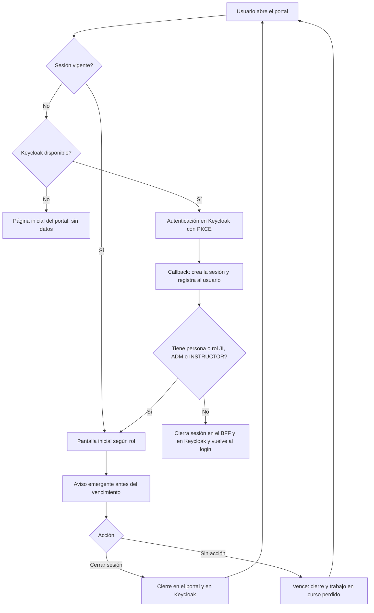
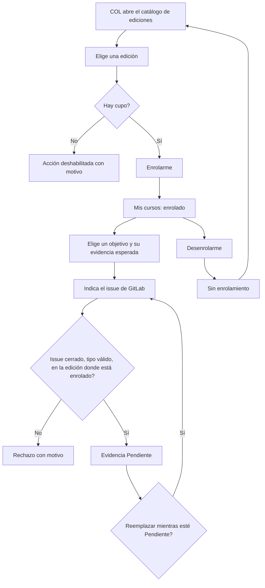
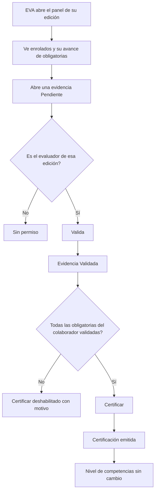
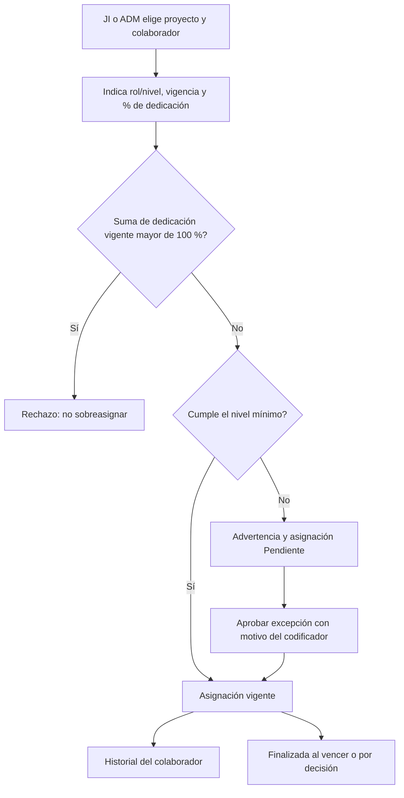
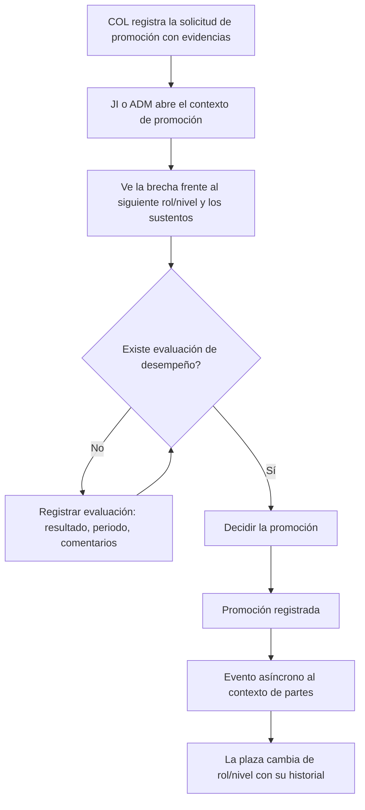

# FLW-001 — Flujos de usuario del portal P3M

> **Estado:** `draft`, sin revisión humana. Cada paso sale de un criterio de aceptación (**hecho**, con su fuente) o de una lectura del agente (**(I)**). No hay investigación con usuarios, ni tiempos, ni frecuencias de uso: ningún flujo se «optimizó» con datos. Las pantallas (`SCR-nn`) son las de [SCR-001](SCR-001-pantallas-del-bff.md).

## 1. Convenciones
- **Rutas rápidas del servidor:** cuando un paso dice «rechazo», lo decide el **servicio** (ADR-P5); la interfaz solo oculta o deshabilita.
- **Actores:** COL colaborador, EVA evaluador (INSTRUCTOR), JI Jefe de Ingeniería, ADM ADMIN, JP jefe de proyecto (no es rol de Keycloak).
- **Estados de interfaz comunes (UXR-X1):** cargando, vacío, error, parcial y sin permiso.
- **Mensajes de rechazo** muestran el motivo de negocio, salvo en el acceso denegado por falta de persona (no se revela la causa).

## 2. FLW-01 Sesión: ingreso, vencimiento y cierre
**Actor:** cualquier usuario. **Pantalla:** SCR-01. **Historias:** US-025, US-027, US-028. **Rutas BFF:** `/auth/*`, `GET /api/v1/me`.

| Paso | Hecho o (I) | Fuente |
|---|---|---|
| Acceso sin autenticar: pide autenticarse y no muestra datos | Hecho | US-027 AC-2 |
| Registro del usuario con GUID, username, correo y roles de Keycloak; vinculación con su persona la primera vez | Hecho | US-025 AC-1 a AC-3 |
| Sin persona ni rol JI, ADM o INSTRUCTOR: no ingresa y se cierran ambas sesiones | Hecho | US-027 AC-4; US-025 AC-4 |
| Keycloak caído: página inicial | Hecho | US-027 AC-5 |
| Aviso emergente del vencimiento | Hecho; **anticipación sin definir** | US-028 AC-4; RQ-31 |
| Cierre a demanda y por vencimiento alineados con Keycloak; cierre en todo el portal; el trabajo en curso se pierde | Hecho | US-028 AC-1, AC-2, AC-3, AC-5, AC-6 |
| La pantalla de rechazo no revela por qué (no confirma si el correo existe) | Hecho | ICP-001 CON-13 |

**Excepciones:** vínculo equivocado o correo reutilizado: no lo corrige el usuario, lo corrige el JI (US-033, K-45). **Estados:** autenticando; sin sesión; sesión por vencer; vencida; acceso denegado.
**Abiertas:** UXQ-5 (tiempo, anticipación y renovación); **¿se ofrece «extender la sesión» en el aviso?** No hay regla (I).

## 3. FLW-02 Enrolamiento y evidencias del colaborador
**Actor:** COL. **Pantallas:** SCR-04, SCR-05. **Historias:** US-009, US-010, US-013. **Vistas:** BFF-V8, BFF-V2.

| Paso | Hecho o (I) | Fuente |
|---|---|---|
| Enrolarse si hay cupo; al llegar al cupo no se admite | Hecho | US-009 AC-1, AC-2 |
| Desenrolarse y volver a enrolarse | Hecho | US-010 AC-1; US-009 AC-4 |
| Solo el colaborador enrolado puede desenrolarse | Hecho | US-010 AC-2 |
| Evidencia: solo issue **cerrado**, y solo en la edición en que está enrolado | Hecho | US-013 AC-2, AC-3 |
| Una evidencia por evidencia esperada, reemplazable mientras esté Pendiente; no hay Rechazada | Hecho | D-H11, US-011 AC-3 |
| El colaborador **pega la URL** del issue y la validación es inmediata | Decisión D-UX-5 (2026-10-13) | UXQ-8 |
| Issue recién cerrado en GitLab pero aún no cargado: el portal lo rechaza hasta la siguiente carga | Hecho | BR-092; ICP-001 CON-10 |

**Excepciones:** el rechazo por «issue no cerrado» puede confundir a quien acaba de cerrarlo; la pantalla debe decir que los datos de GitLab se actualizan en cada carga y mostrar «datos al <fecha UTC-05>» **(I)**. **Estados:** con cupo; sin cupo; ya enrolado; evidencia sin aportar, Pendiente, Validada.

## 4. FLW-03 Validación de evidencias y certificación
**Actores:** EVA (curso), JP (proyecto). **Pantalla:** SCR-06. **Historias:** US-011, US-012, US-015. **Vista:** BFF-V3.

| Paso | Hecho o (I) | Fuente |
|---|---|---|
| Solo el evaluador de **esa** edición valida | Hecho | US-011 AC-2 |
| Evidencia Pendiente → Validada | Hecho | US-011 AC-1, AC-3 |
| Certificar solo con el 100 % de las obligatorias; las deseables no limitan | Hecho | US-012 AC-1 a AC-3 |
| La certificación no cambia por sí sola el nivel de las competencias | Hecho | US-012 AC-4 |
| Variante de proyecto: valida el jefe **vigente** del proyecto del issue | Hecho | US-015; ADR-P5 anexo §3 |
| El JP no es un rol de Keycloak: ve la opción si el servicio lo confirma (CON-09) | **(I)** | ADR-P5 anexo §2 |
| La interfaz avisa al colaborador de que su evidencia fue validada | **(I)** sin regla; no hay notificaciones definidas | — |

**Estados:** edición sin enrolados; evidencias Pendientes; certificable; certificado. **Abiertas:** ¿cómo se entera el JP de que tiene evidencias por validar? No hay vista ni regla **(I)**.

## 5. FLW-04 Asignación a un proyecto y excepción
**Actores:** JI, ADM. **Pantallas:** SCR-03, SCR-07. **Historias:** US-021, US-022, US-023. **Vistas:** BFF-V1, BFF-V4.

| Paso | Hecho o (I) | Fuente |
|---|---|---|
| Asignar con vigencia (desde y hasta) y porcentaje; queda en el historial | Hecho | US-021 AC-5, AC-6 |
| Si no cumple el nivel mínimo: advierte y queda Pendiente | Hecho | US-021 AC-2; INV-22 |
| La excepción la aprueba el JI o ADM con un motivo del codificador | Hecho | US-022; US-023; BR-006, BR-134 |
| No se permite superar el 100 % de dedicación | Hecho | US-021 AC-7 |
| Varias asignaciones a la vez si suman ≤ 100 % | Hecho | US-021 AC-3 |
| Estados: pendiente, vigente, finalizada | Hecho | US-021 AC-8 |
| Dos asignaciones simultáneas del mismo colaborador | `409` para la segunda (bloqueo por colaborador) | ADR-P6; K-31 |
| Mostrar antes de confirmar la dedicación actual del colaborador | **(I)** | — |

**Estados:** asignación solicitada, Pendiente, vigente, finalizada; sobreasignación rechazada; conflicto de concurrencia (reintentar). **Abiertas:** RQ-32 (permisos del jefe de proyecto sobre los roles requeridos); G-08 en US-021.

## 6. FLW-05 Evaluación de desempeño y promoción
**Actores:** JI, ADM (COL registra la solicitud). **Pantalla:** SCR-08. **Historias:** US-017, US-026. **Vista:** BFF-V5.

| Paso | Hecho o (I) | Fuente |
|---|---|---|
| El colaborador registra una solicitud con evidencias | Hecho (la historia de registro está pendiente, RQ-18) | BR-064, BR-068; DDM-001 |
| Ver la brecha entre el nivel actual y el mínimo del siguiente rol/nivel, y los sustentos | Hecho | US-017 AC-1, AC-2 |
| La evaluación es semestral o a demanda; resultado supera, cumple, parcial o no cumple | Hecho | US-026 AC-2, AC-3 |
| La evaluación guarda periodo, comentarios, evidencias consideradas, fecha-hora y usuario | Hecho | US-026 AC-6 |
| Sin evaluación no hay promoción | Hecho | US-017 AC-5; INV-18 |
| Solo JI o ADM decide | Hecho | US-017 AC-4; BR-134 |
| La promoción cambia la plaza de forma **asíncrona** (EVT-01): el rol/nivel visible puede tardar en reflejarse | **(I)** consecuencia del diseño de ICP-001 | ICP-001 §2.2 |

**Estados:** solicitud registrada, evaluada, decidida (D-H13); «aplicando el cambio de plaza» hasta que se refleja **(I)**; sin siguiente rol/nivel. **Decisiones:** el siguiente rol/nivel se deriva de BR-031 y Senior L4 no tiene siguiente (D-UX-2): el botón «Decidir promoción» se bloquea con ese motivo; tras decidir se muestra el estado intermedio (D-UX-7). **Abierta:** RQ-18 (historia de la solicitud).

## 7. Permisos transversales
| Acción | Rol grueso (BFF) | Condición (servicio) |
|---|---|---|
| Enrolar, desenrolar, aportar evidencias de curso | COLABORADOR | Dueño del enrolamiento |
| Validar evidencias de curso, certificar | INSTRUCTOR | Evaluador de esa edición |
| Validar evidencias de proyecto | COLABORADOR (el BFF no sabe quién es JP) | Jefe vigente del proyecto (CON-09) |
| Asignar, aprobar excepción, valorar, evaluar, decidir promoción | JEFE_INGENIERIA, ADMIN | — |

## 8. Preguntas abiertas
Las de [UXR-001](UXR-001-vistas-del-bff.md) §5 y [SCR-001](SCR-001-pantallas-del-bff.md) §7. Nuevas de este documento:
| ID | Pregunta | Dueño | Impacto |
|---|---|---|---|
| FLQ-1 | ¿Se ofrece «extender la sesión» en el aviso de vencimiento? | Responsable funcional | FLW-01 |
| ~~FLQ-2~~ | **Resuelta (D-UX-6):** contadores de pendientes en la barra lateral y en la campana de TopNav, sin bandeja | — | FLW-03, FLW-04 |
| ~~FLQ-3~~ | **Resuelta (D-UX-7):** estado intermedio «promoción registrada, aplicando el cambio de plaza» hasta que la plaza lo refleja | — | FLW-05 |
| ~~FLQ-4~~ | **Resuelta (D-UX-3):** el colaborador ve lo suyo (valoraciones, evidencias, certificaciones, asignaciones) en «Mi progreso» | — | FLW-02, FLW-05 |

## 9. Siguiente acción
Resolver UXQ-1, UXQ-2, UXQ-3, SCRQ-3 y FLQ-1 a FLQ-4. Luego el diseño visual con el IA Design System (`claude-design-orchestrator`), que creará un proyecto en Claude Design y pide tu confirmación.
