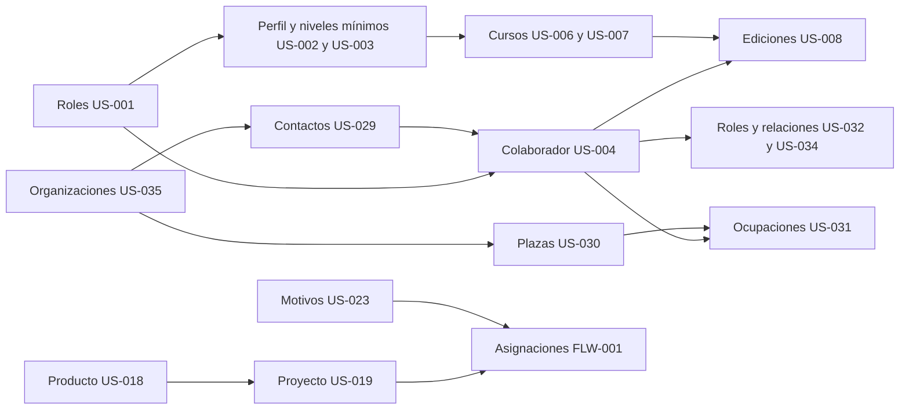
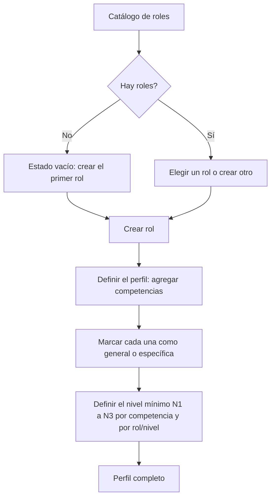
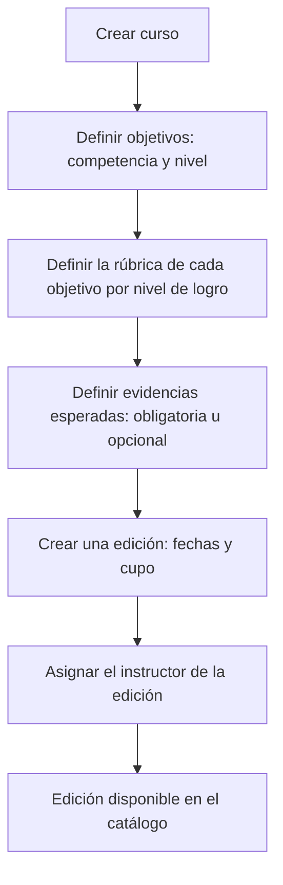
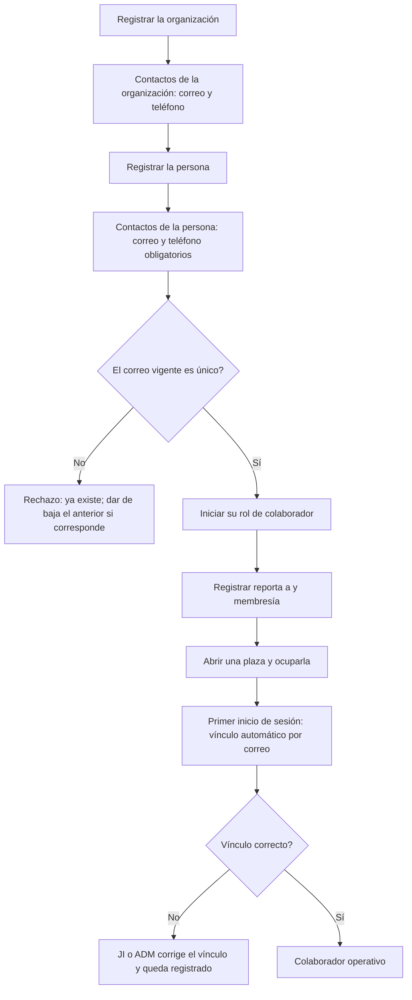
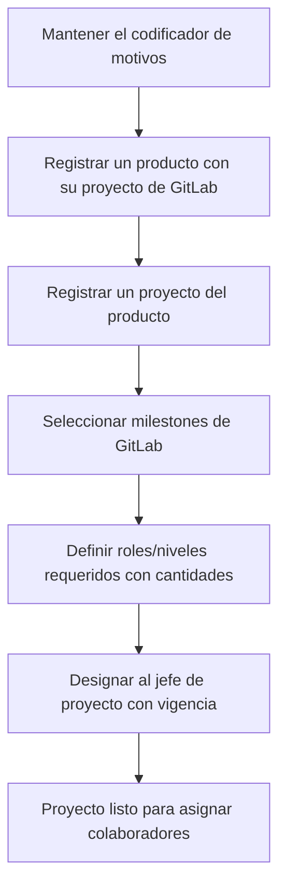
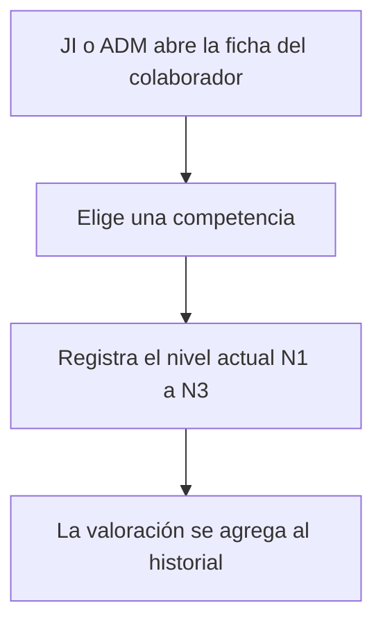

# FLW-002 — Flujos de administración del portal P3M

> **Estado:** `draft`, sin revisión humana. Continúa a [FLW-001](FLW-001-flujos-de-usuario.md). Cada paso sale de un criterio de aceptación (**hecho**) o es **(I)**. Sin investigación con usuarios. Actores: **JI** Jefe de Ingeniería y **ADM** ADMIN, que suple las capacidades exclusivas del JI (BR-134), salvo indicación. Pantallas en [SCR-002](SCR-002-pantallas-de-administracion.md).

## 1. Orden de configuración (I)
Un portal vacío exige un orden. Sale de las dependencias entre historias de DSP-001 y de las referencias entre datos:

Las pantallas deben mostrar **por qué una acción no está disponible** cuando falta un dato previo (por ejemplo, «aún no hay roles»), no ocultarla sin explicación.

## 2. FLW-06 Currícula: rol, perfil y niveles mínimos
**Pantallas:** SCR-11, SCR-12. **Historias:** US-001, US-002, US-003.

| Paso | Hecho o (I) | Fuente |
|---|---|---|
| El catálogo inicia sin roles | Hecho | US-001 AC-4 |
| Crear y modificar roles; un usuario sin permiso no mantiene el catálogo | Hecho | US-001 AC-1 a AC-3 |
| Agregar competencias al perfil; se miden con N1, N2 y N3 | Hecho | US-002 AC-2, AC-3 |
| Una competencia **general** puede estar en varios perfiles; una **específica** solo en uno | Hecho | US-002 AC-4, AC-6; INV-09 |
| El nivel mínimo es un nivel de logro válido y puede diferir entre rol/nivel | Hecho | US-003 AC-2, AC-3 |
| Un rol/nivel exige un mínimo por cada competencia de su perfil | Hecho | INV-11 |
| Dar de alta competencias nuevas desde el mismo flujo | **(I)**: ninguna historia lo dice (H-04) | — |

**Excepciones:** competencia específica ya en otro perfil (rechazo con motivo); nivel mínimo fuera de N1 a N3. **Estados:** catálogo vacío; rol sin perfil; perfil con niveles mínimos incompletos **(I)**. **Abiertas:** ADQ-1 (H-04: ¿quién da de alta competencias?); ADQ-2 (¿qué ocurre al modificar un rol ya usado por colaboradores o plazas?).

## 3. FLW-07 Curso y edición
**Pantallas:** SCR-13, SCR-14. **Historias:** US-006, US-007, US-008.

| Paso | Hecho o (I) | Fuente |
|---|---|---|
| Un curso desarrolla varias competencias; la modalidad no cambia el tratamiento | Hecho | US-006 AC-3, AC-4 |
| Cada objetivo apunta a una competencia y a un nivel y define una rúbrica | Hecho | US-006 AC-2; US-007 AC-1; INV-12 |
| Evidencias obligatorias y opcionales | Hecho | US-007 AC-2, AC-3 |
| Un curso tiene varias ediciones; la edición asigna su instructor | Hecho | US-008 AC-1 a AC-3 |
| El instructor se elige entre personas con rol de evaluador vigente | **(I)**; hace falta listar personas por rol (CON-01 solo valida una) | ICP-001 CON-01 |
| Una edición sin evidencias obligatorias definidas no se puede certificar | **(I)**: consecuencia de INV-14 | — |

**Excepciones:** persona sin rol de evaluador vigente; cupo no positivo **(I)**. **Estados:** curso sin objetivos; objetivo sin rúbrica; edición sin evaluador. **Abiertas:** ADQ-3 (valores de «modalidad»); ADQ-4 (¿se puede modificar un curso con ediciones en marcha?).

## 4. FLW-08 Alta de organizaciones y colaboradores
**Pantallas:** SCR-15, SCR-16, SCR-17, SCR-18 y SCR-03. **Historias:** US-004, US-029 a US-035.

| Paso | Hecho o (I) | Fuente |
|---|---|---|
| Registrar COMSATEL, el Área de Desarrollo y otras organizaciones; inactivarlas | Hecho | US-035 AC-1, AC-2, AC-5 |
| Correo y teléfono obligatorios; el correo vigente es único entre **todas** las partes | Hecho | US-029 AC-2, AC-5; US-035 AC-3, AC-4; BR-133 |
| Más de un contacto; la baja no borra y libera la dirección | Hecho | US-029 AC-3, AC-4, AC-6 |
| Iniciar y terminar roles de la parte, sin solapes del mismo tipo | Hecho | US-032 AC-1 a AC-3 |
| Un «reporta a» y una membresía vigentes | Hecho | US-034 AC-1 a AC-4 |
| Una plaza por colaborador requerido; plaza vacante; una plaza no admite dos ocupantes | Hecho | US-030 AC-2, AC-3; US-031 AC-2 |
| Un único rol/nivel vigente por persona; historial de la plaza | Hecho | US-031 AC-3; US-030 AC-4 |
| El primer inicio de sesión vincula al usuario con la persona por el correo | Hecho | US-025 AC-3; ICP-001 CON-13 |
| Corregir el vínculo, con quién y cuándo | Hecho | US-033 AC-1 a AC-3, AC-5 |
| El orden de pasos de esta pantalla (asistente o secciones sueltas) | **(I)** sin regla | — |
| Avisar al JI de que el correo de Keycloak no coincide con ningún contacto | **(I)**: el usuario ve solo «acceso denegado» sin causa (UXR-S3) | US-027 AC-4 |

**Excepciones:** correo duplicado; ocupación de una plaza ya ocupada; solape de roles. **Estados:** persona sin contacto; plaza vacante; vínculo pendiente. **Abiertas:** ADQ-5 (¿registrar una persona es un asistente de varios pasos o secciones independientes?); ADQ-6 (G-12 de US-004: política de datos personales sin definir, afecta a lo que se pide aquí).

## 5. FLW-09 Portafolio: motivos, producto y proyecto
**Pantallas:** SCR-19, SCR-20 y SCR-07. **Historias:** US-018, US-019, US-023.

| Paso | Hecho o (I) | Fuente |
|---|---|---|
| Crear motivos de excepción; un motivo usado no se retira | Hecho | US-023 AC-1, AC-2 |
| Un producto se vincula a un proyecto de GitLab | Hecho | US-018 AC-1 |
| Un proyecto pertenece a un solo producto y se compone de milestones | Hecho | US-019 AC-1, AC-2; INV-19 |
| Los milestones se **eligen de los ya cargados** desde GitLab; el portal no los crea | Hecho | BR-036; ICP-001 CON-11 |
| Roles/niveles requeridos con cantidades | Hecho | US-019 AC-3 |
| Un solo jefe de proyecto vigente, con historial | Hecho | US-019 AC-4; INV-20 |
| Si aún no se ha cargado ningún milestone, el paso D no tiene datos: se dirige a la consola de cargas | **(I)** | US-020 |

**Excepciones:** milestone ya asignado a otro proyecto (rechazo); motivo en uso (no se retira). **Estados:** producto sin proyectos; proyecto sin milestones; sin jefe vigente. **Abiertas:** RQ-32 (permisos del jefe de proyecto sobre los roles requeridos).

## 6. FLW-10 Valoración del colaborador
**Pantalla:** SCR-21 (desde SCR-03). **Historia:** US-016.

| Paso | Hecho o (I) | Fuente |
|---|---|---|
| Registrar el nivel actual de cada competencia | Hecho | US-016 AC-1 |
| El historial se conserva; las valoraciones solo se agregan | Hecho | US-016 AC-2; INV-16 |
| Solo JI o ADM valora | Hecho | US-016 AC-3 |
| El colaborador ve sus valoraciones en «Mi progreso» | Decisión D-UX-3 | UXR-001 §7 |
| Mostrar la valoración anterior junto al campo para registrar | **(I)** | — |

**Abiertas:** US-016-Q1.

## 7. Preguntas abiertas nuevas
| ID | Pregunta | Dueño | Impacto |
|---|---|---|---|
| ADQ-1 | H-04: ¿quién da de alta las competencias y desde dónde? | Análisis funcional | FLW-06 |
| ADQ-2 | ¿Qué ocurre al modificar un rol que ya tienen colaboradores o plazas? | Análisis funcional | FLW-06 |
| ADQ-3 | ¿Qué valores tiene la modalidad de un curso? | Responsable funcional | FLW-07 |
| ADQ-4 | ¿Se puede modificar un curso con ediciones en marcha? | Responsable funcional | FLW-07 |
| ADQ-5 | ¿Registrar una persona es un asistente de varios pasos o secciones independientes? | UX | FLW-08 |
| ADQ-6 | Política de datos personales (G-12, DT-01) | Responsable funcional | FLW-08 |
| ADQ-7 | Hace falta una lectura «personas por rol vigente» para elegir instructor (no existe en API-PRP-001) | Arquitectura | FLW-07 |

## 8. Siguiente acción
Resolver ADQ-1, ADQ-2, ADQ-3 y ADQ-7 (cambian datos y APIs). Con [SCR-002](SCR-002-pantallas-de-administracion.md) completo, el proyecto de diseño puede abarcar todo el portal.
