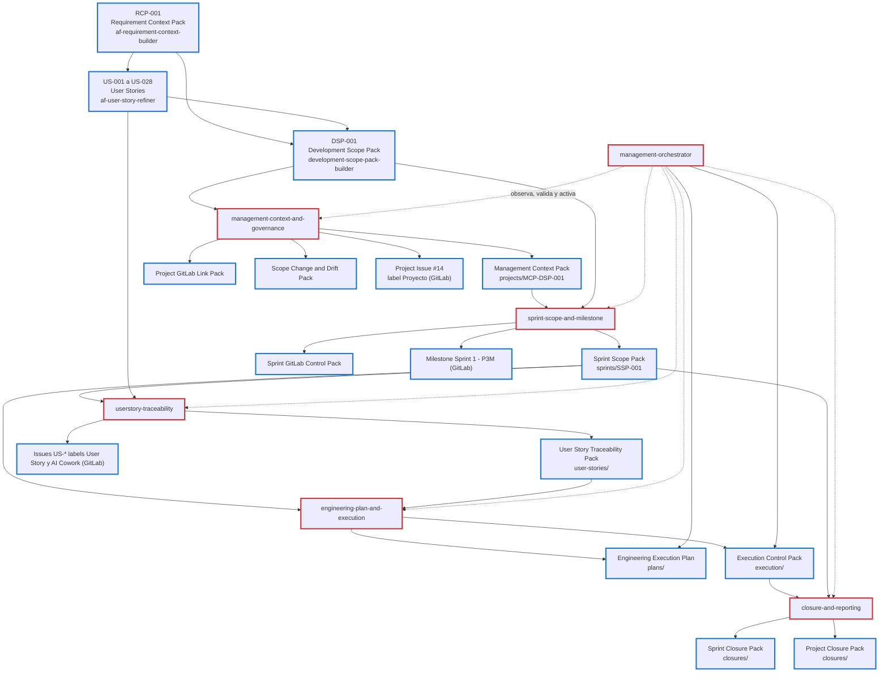

# Mapa de resultados de los skills de gestión

Parte del RCP y del DSP y llega hasta el cierre del proyecto. Se construyó leyendo el `SKILL.md` y las plantillas de cada skill. Los resultados de `engineering-plan-and-execution` y `closure-and-reporting` aún no existen en este proyecto.

## 1. Flujo

Borde rojo: skills de gestión. Borde azul: entregables.

## 2. Resultados por skill

| Skill | Entradas | Resultados | Ubicación | Cambia GitLab |
|---|---|---|---|---|
| (previo) af-requirement-context-builder | Fuentes del negocio | **RCP** | `requirements/context-packs/` | No |
| (previo) af-user-story-refiner | RCP, reglas de negocio | **US-\*** (una por archivo) | `requirements/user-stories/` | No |
| (previo) development-scope-pack-builder | RCP y US-\* | **DSP** | `requirements/scope-packs/` | No |
| management-context-and-governance | DSP, RCP | **Management Context Pack**, **Project GitLab Link Pack**, **Scope Change and Drift Pack**, descripción del **Project Issue** | `management/projects/` y `controls/` | Project Issue (label `Proyecto`), con aprobación |
| sprint-scope-and-milestone | DSP, Management Context Pack | **Sprint Scope Pack** (SSP), **Sprint GitLab Control Pack** | `management/sprints/` | Milestone, con aprobación |
| userstory-traceability | SSP, US-\* | **User Story Traceability Pack**, texto de cada Issue | `management/user-stories/` | Un Issue por US-\* (label `Userstory`), con aprobación |
| engineering-plan-and-execution | SSP, US-\*, dependencias | **Engineering Execution Plan**, **Execution Control Pack** | `management/plans/` y `execution/` | No, sin aprobación |
| closure-and-reporting | SSP, evidencias, Milestone | **Sprint Closure Pack**, **Project Closure Pack** | `management/closures/` | Solo preparado como `PENDING_APPROVAL` |
| management-orchestrator | Todo lo anterior | **Engineering Execution Plan** y **Execution Control Pack** (estado, razón, dependencias, drift, bloqueos y próximas acciones) | `management/` | No, nunca directamente |

## 3. Identificadores que se heredan

| Elemento | Lo origina | Lo reutilizan |
|---|---|---|
| `project_id` (633) | DSP | Todos los skills |
| `issue_id` e `issue_iid` del Project Issue | management-context-and-governance | closure-and-reporting (cierre de proyecto) |
| `milestone_id` y URL | sprint-scope-and-milestone | userstory-traceability, closure-and-reporting |
| `issue_id` e `issue_iid` de cada US-\* | userstory-traceability | engineering-plan-and-execution, closure-and-reporting |

## 4. Estado en este proyecto (2026-10-10)

| Resultado | Estado |
|---|---|
| RCP-001, 28 US-\*, DSP-001 | Hechos y aprobados por el PO |
| Management Context Pack (MCP-DSP-001) | Hecho (`REQUIRES_REVIEW` = `NEEDS_HUMAN_REVIEW`) |
| Project Issue #14 | Creado en GitLab |
| SSP-001 y Milestone 1753 | Creados |
| Texto de los 9 Issues de US-\* | Generado en `management/user-stories/issues/`, sin publicar (permiso de escritura denegado) |
| Traceability Pack | Pendiente: depende de los Issues |
| Engineering Execution Plan, Execution Control Pack | Pendientes |
| Sprint y Project Closure Pack | Pendientes |

## 5. Observaciones del mapa

- `management-orchestrator` no produce resultados de dominio: solo el plan y el control de ejecución. Registra en `management/` lo que producen los demás skills.
- Los tres Packs de `management-context-and-governance` (Management Context, Project GitLab Link y Scope Change and Drift) comparten un solo skill, pero la plantilla existente solo cubre el primero.
- `closure-and-reporting` y `engineering-plan-and-execution` no tienen plantillas, y `management-orchestrator` tampoco. Los Packs `Sprint GitLab Control Pack`, `Project GitLab Link Pack` y `Scope Change and Drift Pack` tampoco tienen plantilla.
- El flujo termina en el Project Closure Pack y no declara un cierre aprobado: lo decide una persona.
